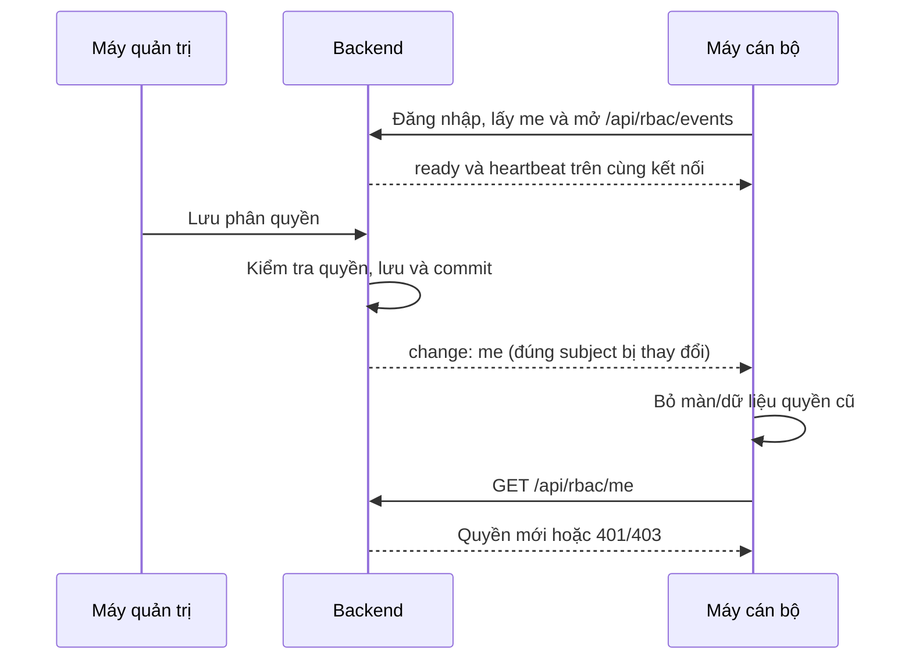

# Đồng bộ quyền và cấu hình bằng SSE

Cập nhật 18/10/2026. Thay polling quyền/danh sách RBAC mỗi 30 giây bằng thông báo vô hiệu hóa dữ liệu. Luồng này dành cho một backend instance; các API nghiệp vụ vẫn kiểm tra quyền từ server trên từng request.

## Luồng hoạt động

`RbacEventsResource` dùng subject của phiên đang đăng nhập, không nhận subject từ client. Stream chỉ có tên nhóm dữ liệu cần đọc lại, phiên bản/revision và cờ làm mới; không gửi tên cán bộ, hồ sơ hộ dân hoặc nội dung quyền. Khi phiên chưa xác thực, endpoint trả 401 thay vì redirect sang trang đăng nhập. Ngoại lệ ASYNC chỉ dành cho phần hoàn tất của chính request SSE đã được xác thực, không mở quyền truy cập GET ban đầu.

`RbacChangeAspect` phát tín hiệu sau khi thao tác thành công. Nếu còn transaction bao ngoài, `RbacEventHub.afterCommit` đợi commit; rollback SQL thông thường không phát thông báo thành công. Ngoại lệ là đồng bộ tài khoản Keycloak thất bại và đã khóa tài khoản: sau audit độc lập `identity-sync-failed-disabled`, phát yêu cầu kiểm tra lại tài khoản vì thay đổi bên Keycloak không thể rollback cùng SQL. Đây không phải thông báo lưu quyền thành công.

| Thay đổi | Nơi nhận |
| --- | --- |
| Phân quyền, ấp/tuyến, tài khoản, khóa/xóa tài khoản | `me` của đúng subject; `users` để các màn quản trị cập nhật danh sách được phép |
| Menu, đơn vị, cảnh báo, danh sách chặn | Nhóm tương ứng; mỗi subscription chỉ đọc lại nhóm mình đang dùng |
| Policy, whitelist, blacklist | Đọc lại cấu hình tương ứng và kiểm tra `me`; tài khoản không bị ảnh hưởng giữ màn đang mở, tài khoản bị từ chối bị gỡ khỏi dashboard |
| Chuyển người phụ trách hồ sơ | Vô hiệu hóa `me` của cả người cũ và người mới; transaction giữ khóa ngắn trên `rbac_record_scope` để lấy đúng chủ cũ khi có thao tác đồng thời |
| Sửa ranh/đơn vị ấp | Làm mới quyền/dữ liệu không gian vì hình học được phép có thể đổi mà version profile giữ nguyên |

## Kết nối và tải lại

- Một `EventSource` có credentials dùng chung cho tất cả subscription trong một tab, không mở riêng một stream cho từng API. Đổi phiên/tài khoản sẽ đóng kết nối cũ.
- Các nhóm dữ liệu tải lần đầu khi subscribe; sau đó chỉ tải khi có tín hiệu đúng nhóm, thao tác lưu cục bộ, hoặc cần đối chiếu sau reconnect. Không còn timer GET `me/users/whitelist/menus/units/alerts` mỗi 30 giây.
- Backend gửi `ping` mỗi 20 giây trên stream. Frontend chỉ gia hạn watchdog, không gọi API do heartbeat.
- Lần bắt tay đầu kiểm tra lại snapshot để khép khoảng trống giữa GET ban đầu và đăng ký stream. Request dồn trong 25 ms được gộp; nếu thay đổi đến lúc request đang chạy, bỏ phản hồi cũ và thực hiện một lượt tiếp theo.
- Stream im lặng quá 65 giây hoặc báo lỗi sẽ được đóng và kết nối lại với backoff 1–60 giây cộng jitter. Chỉ có một timer reconnect/watchdog; unsubscribe dọn timer, listener và request.
- Mỗi stream tồn tại tối đa 30 phút rồi kết nối lại để xác thực phiên mới. Backend có revision dữ liệu và revision quyền cùng ID instance. Reconnect không có thay đổi chỉ kiểm tra `me`, không tải lại các danh sách hoặc đóng form. Nếu bỏ lỡ thay đổi cấu hình thì tải lại các nhóm; nếu có thể bỏ lỡ thay đổi quyền/scope thì gỡ dữ liệu cũ trước khi lấy quyền mới. Backend khởi động lại tạo ID mới, buộc đối chiếu lại.
- Quay về tab/online kiểm tra `me`; stream tiếp tục truyền thay đổi. Nếu tải quyền lỗi có nút **Thử tải lại quyền**. Không dùng trạng thái EventSource thay cho kết quả xác thực API.
- Backend gửi bằng virtual thread ngoài transaction, gộp pending theo kết nối, không giữ lịch sử sự kiện tăng dần. Có cleanup khi complete/error/timeout, giới hạn 16 kết nối/subject và 4.096 kết nối/instance.

`health` là luồng riêng, vẫn kiểm tra mỗi 30 giây như trước. Danh sách quản trị vẫn được tải lần đầu theo subscription hiện tại; chưa chuyển toàn bộ sang chỉ tải khi mở menu.

## Vận hành và giới hạn

Backend và frontend phải cùng chạy code mới; nếu devtools/HMR chưa reload, khởi động lại backend rồi tải lại trang. Không có migration hoặc thay đổi hồ sơ/quyền trong đợt này. Reverse proxy phải chuyển tiếp streaming và không buffer `/api/rbac/events`; endpoint trả `Cache-Control: no-store` và `X-Accel-Buffering: no`. Kiểm tra timeout proxy lớn hơn khoảng heartbeat.

Hub hiện nằm trong một JVM, chưa có broker/pub-sub giữa nhiều instance. Khi triển khai nhiều backend sau load balancer, phải bổ sung bus chung trước khi dựa vào push giữa các node. Chỉnh trực tiếp SQL hoặc Keycloak ngoài các đường ghi của app không tự phát SSE; backend vẫn từ chối API trái quyền, còn UI đối chiếu lại khi focus/reconnect. Không coi kết nối đang mở là bảo đảm đã nhận được mọi sự kiện.

Tham khảo cơ chế streaming/heartbeat của [Spring MVC](https://docs.spring.io/spring-framework/reference/6.2/web/webmvc/mvc-ann-async.html) và nguyên tắc gắn thông báo với [commit transaction](https://docs.spring.io/spring-framework/reference/6.2/data-access/transaction/event.html).

## Kiểm chứng

Test tự động bao gồm: đúng subject/không lộ phiên bản của người khác; commit/rollback và Spring AOP proxy thật; chủ hồ sơ cũ/mới; cleanup và gộp pending; anonymous bị chặn, request SSE hoàn tất ASYNC; một stream/tab, heartbeat không gọi GET, reconnect có/không bỏ lỡ thay đổi, bỏ phản hồi cũ, hủy request phiên cũ và không polling khi đứng yên.

Log: `target/rbac-events-gis.log`, `target/rbac-events-backend.log`, `target/rbac-events-types.log`, `target/rbac-events-lint.log`, `target/rbac-events-build.log`. Có một test ngoài phạm vi đang lệch giữa backend và kỳ vọng ẩn `vietmap-compare`: `RbacMenuRemovalTest`; phần lọc menu đó không được sửa. Lỗi được giữ tại `target/rbac-events-baseline-menu-failure.log`, không tuyên bố toàn bộ backend sạch test.

Kết quả local: 36 file/143 test GIS và 75 test backend mục tiêu đạt; TypeScript, lint sáu file service/test RBAC và production build đạt. Các log trong `target` có thể bị ghi đè, cần gắn với snapshot/commit khi nghiệm thu release.

Chưa nghiệm thu với hai trình duyệt có đăng nhập hoặc reverse proxy thật. Cần mở tài khoản quản trị và cán bộ ở hai phiên, đổi phạm vi/quyền, xác nhận cán bộ nhận `change` và gọi lại `me`; thử khóa tài khoản, mất mạng rồi nối lại và để idle để xác nhận chỉ stream/health còn hoạt động định kỳ.
