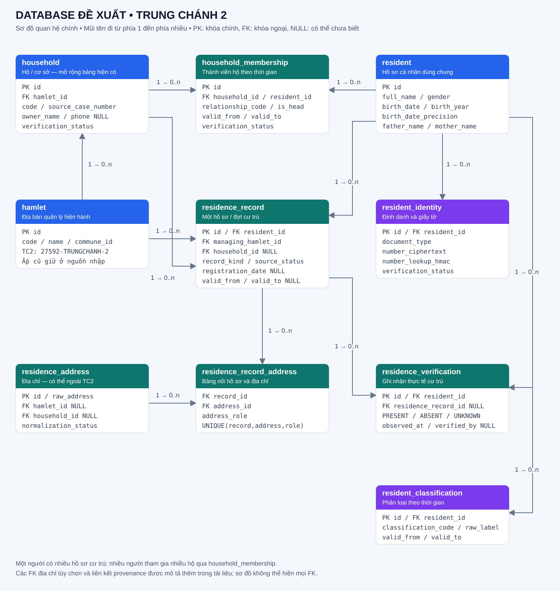
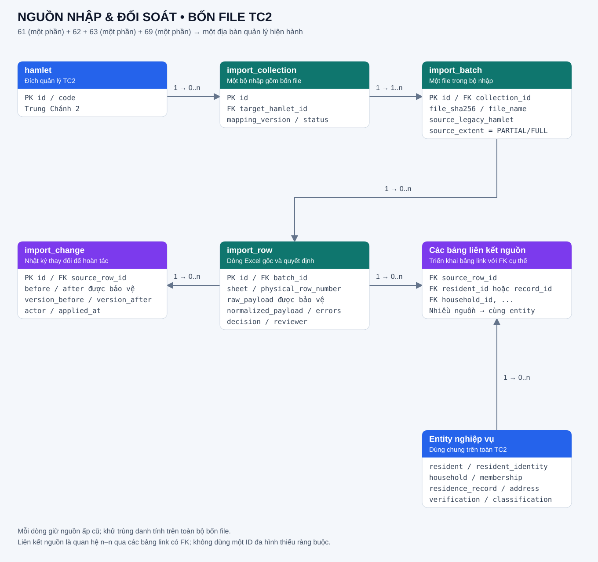

# Quan hệ database đề xuất cho TC2

> Cập nhật 27/10/2026: đã hợp nhất vào bảng lõi và bỏ mock khỏi dữ liệu nghiệp vụ. Xem [cấu trúc, hai menu, flow và recovery sau hợp nhất](../luong-hop-nhat-ho-dan-nhan-khau.md). Các số liệu/mô tả cách ly bên dưới là mốc triển khai trước.

> Cập nhật 20/10/2026: xem [schema thực tế, kết quả nhập và recovery](../tc2-roster-implementation.md). Hình bên dưới là thiết kế mục tiêu; bản triển khai đầu lưu phân loại nguồn trong hồ sơ cư trú và thông tin ấp cũ tại batch/source row.

Đây là thiết kế mục tiêu cho bốn file, chưa phải schema đã triển khai. Xem [phân tích nguồn và mapping](../phan-tich-mapping-dsnk-trung-chanh-2.md).

| Quan hệ | Bội số | Ý nghĩa |
| --- | --- | --- |
| hamlet → household | 1 : 0..n | TC2 quản lý nhiều hộ/cơ sở; giữ bảng hiện có |
| resident ↔ household | n : n | Qua household_membership, có vai trò và thời gian hiệu lực |
| resident → resident_identity | 1 : 0..n | Một người có thể có nhiều loại giấy tờ/lịch sử định danh |
| resident → residence_record | 1 : 0..n | Nhiều hồ sơ/đợt thường trú, tạm trú, NOHT, nguồn Đ19 |
| hamlet → residence_record | 1 : 0..n | managing_hamlet_id xác định địa bàn quản lý hồ sơ |
| household → residence_record | 1 : 0..n | FK household_id tùy chọn; hồ sơ chưa đối soát hộ vẫn được giữ |
| residence_record ↔ residence_address | n : n | Qua residence_record_address, phân biệt nơi thường trú/hiện tại/tạm trú/trước chuyển đến |
| resident → residence_verification | 1 : 0..n | Các ghi nhận thực tế cư trú; có thể gắn thêm một residence_record |
| resident → resident_classification | 1 : 0..n | Phân loại và hiệu lực, phân biệt không thuộc diện với chưa biết |
| hamlet → import_collection | 1 : 0..n | Bộ nhập được giới hạn scope TC2 |
| import_collection → import_batch | 1 : 1..n | Bộ nguồn lần này gồm bốn file; bộ mới có thể khác số lượng |
| import_batch → import_row | 1 : 0..n | Giữ sheet, dòng vật lý, raw nguồn, lỗi và quyết định |
| import_row ↔ entity đích | n : n | Các bảng link có FK cụ thể giữ nhiều nguồn cho cùng hồ sơ |
| import_row → import_change | 1 : 0..n | Lưu thay đổi trước/sau và version để kiểm tra hoàn tác |

FK tùy chọn chưa vẽ đầy đủ trên hình: residence_address.hamlet_id và household_id; residence_record.address_id là địa chỉ chính, đồng thời bảng nối lưu các địa chỉ theo vai trò. resident_id và residence_record_id trên verification phải cùng người, được service kiểm tra và có thể bổ sung ràng buộc FK tổng hợp khi triển khai. Các bảng nghiệp vụ có audit/version và provenance theo thiết kế chi tiết; hình chỉ giữ trường chính để dễ đọc.

household_membership thể hiện nhiều hộ theo thời gian, không mặc định một người được làm chủ nhiều hộ thường trú đồng thời. Ràng buộc theo loại hộ/hiệu lực phải được chốt trong nghiệp vụ. Các loại NOHT/Đ19 giữ phân loại nguồn trước khi chốt ánh xạ chính thức.

Quy tắc cốt lõi: một danh tính dùng chung trên toàn TC2; nhiều hồ sơ cư trú không tạo nhiều người. Các phần ấp 61/63/69 và ấp 62 được giữ tại nguồn nhập, không tạo bốn danh sách nhân khẩu độc lập. Địa chỉ ngoài TC2 giữ nguyên, không đổi theo scope bộ nhập. Ngày sinh chỉ có năm giữ precision YEAR; ô thiếu và dấu xác minh trống giữ UNKNOWN.
