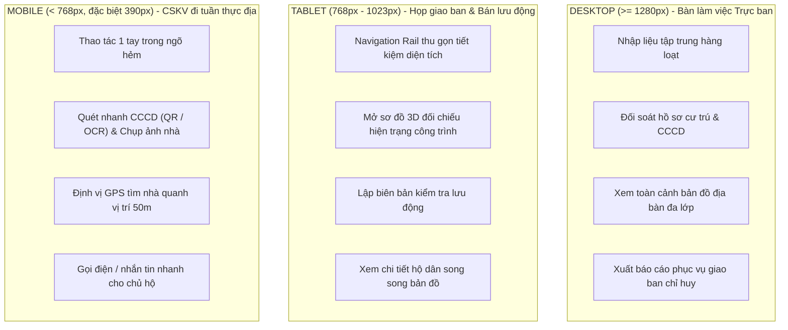
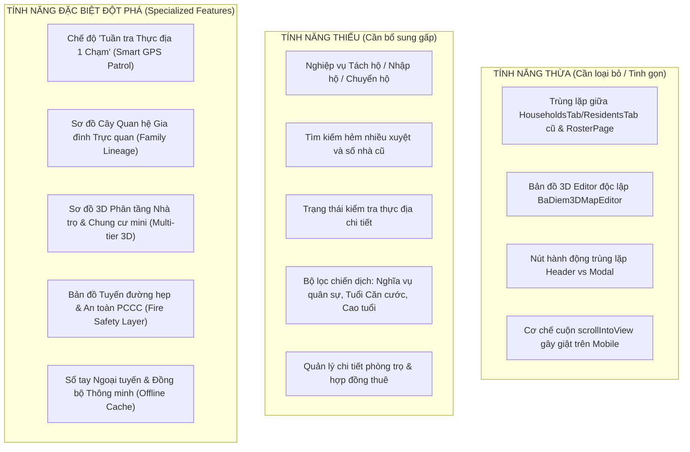

# BÁO CÁO PHÂN TÍCH CHUYÊN SÂU UI/UX ĐA THIẾT BỊ VÀ KẾ HOẠCH NÂNG CẤP NGHIỆP VỤ CÔNG AN CƠ SỞ

> **Ứng dụng:** Hệ thống Quản trị & Điều hành Địa bàn Hành chính - Dân cư (Công an xã Bà Điểm)  
> **Phiên bản khảo sát:** Monolithic GIS & Unified Roster 2026  
> **Chuẩn thiết kế gốc:** `design-system/municipal-administration/MASTER.md` (Style: *Accessible & Ethical*, Bảng màu hành chính `#1c4e3a`)  
> **Đối tượng người dùng mục tiêu:** Cảnh sát khu vực (CSKV), Công an viên xã, Cán bộ ấp/khu phố, Ban chỉ huy Công an xã/phường.

---

## 1. Mục tiêu & Tổng quan Hiện trạng (Executive Summary)

### 1.1. Bối cảnh Nghiệp vụ Thực tế
Công an cấp xã/phường và lực lượng Cảnh sát khu vực (CSKV) hiện nay đang chịu áp lực rất lớn trong việc thực hiện Luật Cư trú năm 2020, Luật Căn cước năm 2023 và Đề án 06/CP:
- Dữ liệu dân cư phải đảm bảo tiêu chí **"Đúng, Đủ, Sạch, Sống"** theo thời gian thực.
- Địa bàn ngoại thành như xã Bà Điểm (huyện Hóc Môn, TP.HCM) có tốc độ đô thị hóa nhanh, dân số cơ học đông, nhiều dãy nhà trọ, nhà ngăn phòng, ngõ hẻm chằng chịt nhiều cấp xuyệt (`/`), nhà không số hoặc số nhà cũ/mới đan xen.
- Cán bộ không chỉ ngồi tại bàn làm việc ở đồn mà phải **trực tiếp xuống địa bàn, đi từng ngõ, gõ từng nhà, rà từng người**, làm việc cả ban ngày lẫn ban đêm, trong điều kiện nắng mưa, di chuyển bằng xe máy hoặc đi bộ trong hẻm hẹp.

### 1.2. Hiện trạng Hệ thống Hiện tại
Hệ thống hiện tại gồm 11 phân hệ chức năng:
1. `overview`: Bảng điều khiển Tổng quan & Cảnh báo an ninh.
2. `documents`: Quản lý Hồ sơ Cư trú (Thường trú, Tạm trú, Tạm vắng).
3. `households`: Danh sách Hộ dân & Địa chỉ cư trú (Unified Roster).
4. `residents`: Quản lý Nhân khẩu & Căn cước công dân (Unified Roster).
5. `area-map`: Bản đồ Phân bố & Giám sát Địa bàn 2D (SVG/HTML Grid).
6. `areas`: Quản lý Khu vực & Địa giới Hành chính (51 ấp xã Bà Điểm trong bảng `hamlet`).
7. `field-3d-map`: Bản đồ 3D Không gian Thực địa (MapLibre GL + Three.js building layers).
8. `logs`: Nhật ký Thao tác & Kiểm toán Hệ thống.
9. `subadmin-delegation`: Phân quyền & Giám sát Cán bộ Khu vực theo ấp.
10. `superadmin-hub`: Trung tâm Điều hành & Quản trị Hệ thống.
11. `settings`: Thiết lập Hệ thống & Trạng thái Kết nối.

---

## 1.3. Nguyên tắc Dữ liệu Thật (bắt buộc cho mọi đề xuất)

1. Mọi số liệu, danh sách, bộ lọc phải đến từ API backend và PostgreSQL. Không dùng hằng số, fixture hay `localStorage` cho dữ liệu nghiệp vụ.
2. Trường chưa có dữ liệu hiển thị "Chưa ghi nhận", không suy diễn hay điền giả (giữ quy tắc của `recordedApiData.spec.ts`).
3. Mỗi tính năng mới đi theo chuỗi: Liquibase (schema, constraint) -> backend (RBAC, audit) -> API -> frontend -> test. Không làm giao diện trước khi có dữ liệu.
4. Không thêm dữ liệu mẫu vào context `dev/prod/test`; dữ liệu kiểm thử chỉ nằm trong test fixture hoặc Testcontainers.
5. Thao tác ghi (check-in, tách hộ) phải qua RBAC, kiểm tra phạm vi ấp, ghi `change_event` và idempotent theo mẫu `request_receipt`.
6. Dữ liệu nhập tay mới (hẻm hẹp, trụ nước, phòng trọ) phải có `source`, `recorded_by`, `recorded_at`; chưa có thì lớp bản đồ ẩn hoặc báo trống.
7. Toạ độ hộ có `coordinate_method = RANDOM_WITHIN_TC2` hoặc `UNLOCATED` là chưa xác minh, không dùng cho tuần tra GPS.

### Hiện trạng nguồn dữ liệu đã đối chiếu với mã nguồn
- **Đã là dữ liệu thật:** `/api/roster/*`, `/api/gis/households/{browse,overview}`, `/api/legal-documents`, `/api/rbac/*`, `/api/gis/field-buildings`, ảnh kiểm tra. Nguồn gốc là Excel TC2 nhập qua `import_collection/batch/row`; dữ liệu mock cũ đã archive sang `legacy_mock_20261027`.
- **Không phải dữ liệu DB, cần xử lý ở Giai đoạn 1:**
  - `BaDiem3DMapEditor.tsx` lưu nháp vào `localStorage['ba_diem_3d_buildings_custom']` và đọc JSON tĩnh.
  - `gis/firebase.ts`, `firebase-applet-config*.json` và dependency `firebase` là code chết.
  - `seedAuthAndRbacData` là no-op nhưng vẫn được gọi ở `App.tsx`.
- **Chấp nhận được (tài sản tĩnh, không phải dữ liệu nghiệp vụ):** `defaultMenus.ts`, ranh giới xã và lớp raster bản đồ đóng gói sẵn.

### Khoảng trống dữ liệu (chưa có trong DB)

| Đề xuất | Dữ liệu thật hiện có | Việc phải làm ở backend/DB |
| :--- | :--- | :--- |
| Bộ lọc chiến dịch | `resident.birth_date/birth_year/birth_date_precision`, `gender`, `residence_record.record_kind/valid_to` | Thêm tham số lọc vào `/api/roster/households|residents` (`RosterService`). Chỉ tính tuổi chính xác khi `birth_date_precision = DAY`; nếu chỉ có năm thì ghi chú độ chính xác. Không dùng `/api/residents` (entity JPA chưa map `birth_date`). |
| Tìm hẻm nhiều xuyệt, số nhà cũ | `alley`, `street`, `raw_address`, `legacy_address` (chuỗi tự do) | GĐ2: tìm tiền tố trên `raw_address` có index, không đổi schema. Sau đó (nếu duyệt): cột `alley_path`, `old_house_number` bằng Liquibase, backfill có kiểm đếm, dòng không parse được để NULL. |
| Trạng thái rà soát thực địa | `residence_verification.presence_status`, `observed_at`, `verified_by`, `method`; `household.last_checked_date` | "Vắng lần 1/2" tính từ số lần ABSENT liên tiếp trong lịch sử. `MOVED_AWAY`, `UNCOOPERATIVE` cần mở rộng enum bằng Liquibase. |
| Tách / nhập hộ | `household_membership` (valid_from/to, unique current head), `POST /memberships/{id}/transfer` | Endpoint mới tách hộ (tạo hộ mới + chuyển nhóm thành viên) trong một transaction, giữ lịch sử và audit. |
| Cây quan hệ gia đình | `relationship_code`, `is_head`, `father_name`, `mother_name` | GĐ đầu chỉ nhóm theo `relationship_code`, không vẽ quan hệ vợ/chồng/con suy đoán. Đồ thị thật cần bảng quan hệ mới. |
| Tuần tra GPS 50m | `household.latitude/longitude` + `coordinate_method`; `/api/gis/field-buildings/household-positions`; PostGIS | Endpoint "gần nhất" dùng `ST_DWithin/ST_Distance`, chỉ trả hộ có vị trí `VERIFIED` hoặc liên kết công trình. Check-in ghi vào `residence_verification` kèm toạ độ, thời gian, RBAC, audit. Trình duyệt chỉ lấy vị trí cán bộ để truy vấn, không lưu liên tục. |
| 3D phân tầng | `gis_building.floor_count/height_m`, `feature_json` (tối đa 20 tầng / 70 m) | Cắt tầng chỉ dựa trên số tầng thật. Phòng và người thuê cần bảng `building_room` + gán thành viên, nhập liệu thật trước khi vẽ. Chưa có thì không hiển thị phòng. |
| PCCC (hẻm <3,5m, trụ nước, lối thoát nạn) | Không có | Cần nguồn khảo sát thật (xem câu hỏi mở). Chưa có dữ liệu thì chỉ ghi mục tiêu, không mock. |
| Ngoại tuyến / đồng bộ | Chưa có | Lưu bản sao dữ liệu cư dân trên thiết bị: không lưu CCCD đầy đủ, mã hoá, xoá khi đăng xuất/hết phiên, đúng phạm vi RBAC, hàng đợi ghi idempotent theo `request_id`, phát hiện xung đột bằng `updated_at`. Làm sau cùng, cần duyệt riêng. |

---

## 2. Phân tích Chuyên sâu UI/UX theo 3 Phân khúc Thiết bị

### 2.1. Phân khúc Desktop (`>= 1280px` & `1440px`) - Bàn làm việc & Chỉ huy

| Yếu tố UI/UX | Hiện trạng | Đánh giá Trải nghiệm Cán bộ | Điểm nghẽn (Friction Points) | Đề xuất Cải tiến |
| :--- | :--- | :--- | :--- | :--- |
| **Bố cục khung (Layout Frame)** | Sidebar cố định 256px (`w-64`), Header 56px (`h-14`), không gian nội dung mở rộng linh hoạt. | Rõ ràng, trang trọng, chuẩn màu hành chính `#1c4e3a`. | Chưa có cơ chế chia đôi màn hình (Split-Screen / Master-Detail) khi đối chiếu hồ sơ. | Bổ sung chế độ chia màn hình song song: Bảng danh sách bên trái - Bản đồ vị trí nhà bên phải. |
| **Bảng dữ liệu (Data Grid)** | Bảng nhiều cột, có phân trang cố định (10/20/50 dòng), có tìm kiếm và lọc. | Đọc tốt tiếng Việt, có `tabular-nums` cho số liệu. | Thiếu tính năng tùy chọn cột hiển thị (Column Visibility Picker); thiếu thao tác phím tắt nhập nhanh. | Thêm phím tắt chuyên nghiệp (`Enter` nhảy ô, `Ctrl+S` lưu, `Alt+N` thêm hộ mới); cho phép ẩn/hiện cột. |
| **Bản đồ 3D (`field-3d-map`)** | Chiếm toàn màn hình, thanh công cụ bên phải, drawer chi tiết công trình bên phải. | Trực quan, công trình nhấp nhô chân thực theo thẩm quyền cán bộ. | Bảng chỉnh sửa thuộc tính khối nhà (`FieldHousePropertiesEditor`) còn đơn điệu, chưa gắn liền với hồ sơ cư trú. | Cho phép bấm vào khối nhà mở ngay danh sách tất cả các hộ/phòng đang cư trú trong nhà đó. |

### 2.2. Phân khúc Tablet (`768px` - `1023px`) - Họp Giao ban & Tuần tra Bán lưu động

| Yếu tố UI/UX | Hiện trạng | Đánh giá Trải nghiệm Cán bộ | Điểm nghẽn (Friction Points) | Đề xuất Cải tiến |
| :--- | :--- | :--- | :--- | :--- |
| **Thanh điều hướng** | Navigation Rail thu nhỏ (`w-16`), chỉ hiện icon, bấm mở rộng khi cần. | Tiết kiệm diện tích màn hình ngang, không che nội dung. | Khi mở modal lớn (chi tiết hộ dân), nội dung bị cuộn dọc quá dài. | Tổ chức nội dung modal theo tab ngang (Thông tin - Nhân khẩu - Lịch sử - Hình ảnh) thay vì cuộn dọc một cột. |
| **Bản đồ 2D/3D** | Tích hợp Sticky Quick Inspector Bar ở đáy màn hình để xem hộ đang chọn. | Giúp xem ngay hộ dân mà không phải cuộn danh sách 48 thẻ. | Thao tác cảm ứng xoay 3D (pitch/bearing) đôi khi bị nhầm lẫn với thao tác cuộn trang web. | Bổ sung nút khóa cử chỉ bản đồ (Gesture Lock/Unlock) riêng biệt cho màn hình cảm ứng tablet. |

### 2.3. Phân khúc Mobile (`< 768px`, chuẩn 390px - 414px) - Cán bộ CSKV Đi tuần Từng Ngõ Hẻm

| Yếu tố UI/UX | Hiện trạng | Đánh giá Trải nghiệm Cán bộ | Điểm nghẽn (Friction Points) | Đề xuất Cải tiến |
| :--- | :--- | :--- | :--- | :--- |
| **Vùng ngón tay cái (Thumb Zone)** | Bottom Nav 4 tab chính (`h-14` kèm Safe Area). | Chuyển tab nhanh chóng bằng ngón tay cái khi cầm máy 1 tay. | Nút hành động cốt lõi ("Lưu", "Xác minh", "Chụp ảnh") vẫn nằm ở đầu modal hoặc góc trên bên phải. | Đưa toàn bộ nút hành động chính xuống **Sticky Bottom Bar** cố định ở đáy màn hình di động. |
| **Tra cứu tại hiện trường** | Ô tìm kiếm đặt ngay màn hình đầu tiên, bảng chuyển thành danh sách thẻ 2 tầng. | Đáp ứng chuẩn màn hình đầu tiên, tìm kiếm không cần cuộn. | Cán bộ phải dừng lại gõ bàn phím ảo giữa đường nắng chói hoặc khi đeo găng tay. | Tối ưu tính năng tìm kiếm bằng giọng nói tiếng Việt và bổ sung **chế độ tự động tìm nhà quanh vị trí GPS 50m**. |
| **Độ ổn định mạng** | Phụ thuộc hoàn toàn vào kết nối mạng trực tuyến với backend Spring Boot. | Hoạt động tốt trong mạng LAN trụ sở hoặc nơi có 4G khỏe. | Khi đi sâu vào ngõ hẻm hoặc tầng hầm chung cư bị mất sóng, ứng dụng báo lỗi kết nối và không xem được dữ liệu. | Triển khai **Bộ đệm ngoại tuyến (Offline Cache / IndexedDB)** cho phép tra cứu và ghi nhận kết quả kiểm tra khi mất sóng. |

---

## 3. Phân tích Chi tiết UX Trải nghiệm Cán bộ theo 4 Nhóm Nghiệp vụ Cốt lõi

### 3.1. Nghiệp vụ Quản lý Địa bàn (Territory Management)
- **Hành trình hiện tại:** Cán bộ chọn ấp từ thanh địa bàn (`TerritoryScopeBar`) -> xem số hộ, số nhân khẩu, danh sách công trình thuộc ấp được phân công.
- **Vấn đề trải nghiệm:**
  - Chưa hỗ trợ trực quan hóa **ranh giới tổ dân phố** chi tiết bên trong ấp.
  - Cán bộ không có công cụ đánh dấu **"Điểm nóng an ninh trật tự"** (ví dụ: bãi xe tự phát, tụ điểm cờ bạc, khu trọ thường xuyên xảy ra mâu thuẫn).
  - Thiếu tính năng **Nhật ký ca tuần tra** (Ghi nhận thời gian bắt đầu đi tuần, các tuyến đường/hẻm đã tuần tra, ghi chú sự cố trong ca).

### 3.2. Nghiệp vụ Hồ sơ Hộ dân (Household Records)
- **Hành trình hiện tại:** Vào tab `households` -> tìm kiếm theo chủ hộ hoặc số nhà -> click mở `HouseholdDetailModal` -> xem nhân khẩu, ghi chú, xem ảnh kiểm tra.
- **Vấn đề trải nghiệm:**
  - **Địa chỉ nhiều cấp xuyệt của TP.HCM:** Hệ thống chỉ có trường `street`, `houseNumber` và `alley`. Khi tìm kiếm một nhà ở hẻm `120/45/8/2A`, cán bộ rất khó lọc được các hộ thuộc cùng tuyến nhánh.
  - **Chưa có nghiệp vụ Tách hộ / Nhập hộ:** Trong thực tế, khi con cái lập gia đình hoặc bán nhà một phần, việc tách thành 2 hộ chung địa chỉ xảy ra liên tục. Cán bộ hiện phải xóa và tạo lại thủ công, làm mất lịch sử cư trú.
  - **Trạng thái rà soát thực địa chưa rõ ràng:** Hiện chỉ có nhãn trạng thái tổng quát (`normal`, `warning`, `business`). Chưa có các trạng thái nghiệp vụ chuẩn như: *"Đã kiểm tra tháng này"*, *"Đã kiểm tra 3 lần không gặp"*, *"Chủ hộ đi vắng dài ngày"*, *"Hộ đã giải tỏa/chuyển đi"*.

### 3.3. Nghiệp vụ Quản lý Nhân khẩu (Resident Demographics)
- **Hành trình hiện tại:** Vào tab `residents` -> xem danh sách công dân -> lọc theo cư trú, giới tính, độ tuổi -> xem số CCCD (được kiểm soát quyền và audit log bảo mật).
- **Vấn đề trải nghiệm:**
  - **Thiếu Cây quan hệ gia đình trực quan:** Mối quan hệ giữa các thành viên chỉ là chữ viết phẳng (`Chủ hộ`, `Vợ`, `Con`). Nhìn vào một hộ 8–10 người, cán bộ không thể nắm bắt ngay cấu trúc gia đình, ai là vợ chồng, ai là con cái, ai là người ở nhờ.
  - **Phân loại đối tượng nghiệp vụ còn quá đơn giản:** Chỉ có duy nhất một cờ bật tắt `isMonitored: boolean` (Cần chú ý). Thực tế công an cần phân loại rõ: *Người tha tù trước thời hạn*, *Người chấp hành án treo*, *Đối tượng quản lý sau cai nghiện*, *Đối tượng nghi vấn*, *Người nước ngoài cư trú*, để áp dụng tần suất kiểm tra theo đúng quy định pháp luật.
  - **Thiếu bộ lọc Chiến dịch Nghiệp vụ:** Chưa có bộ lọc nhanh phục vụ các đợt cao điểm:
    - *Nghĩa vụ quân sự:* Lọc nam thanh niên từ đủ 18 đến hết 27 tuổi có hộ khẩu thường trú.
    - *Cấp đổi thẻ Căn cước (Luật Căn cước 2023):* Lọc công dân đến các mốc tuổi 14, 25, 40, 60 tuổi.
    - *An sinh xã hội:* Lọc người cao tuổi từ 80 tuổi trở lên.

### 3.4. Nghiệp vụ Sơ đồ 3D Địa bàn (Spatial 3D & Buildings)
- **Hành trình hiện tại:** Vào tab `field-3d-map` -> bản đồ MapLibre tải các khối nhà 3D -> Three.js dựng hiệu ứng nhấp nhô chân thực áp dụng riêng cho các khối nhà thuộc ấp của cán bộ -> click chọn công trình -> xem liên kết hộ dân.
- **Vấn đề trải nghiệm:**
  - **Khối nhà hiện thị dạng đặc (Solid Volume):** Với các công trình nhà trọ nhiều tầng (3–5 tầng, 20–30 phòng trọ) hoặc chung cư mini, cán bộ nhìn từ ngoài chỉ thấy một khối hộp chữ nhật, hoàn toàn không biết bên trong có bao nhiêu phòng và phòng nào đang có người cư trú.
  - **Thiếu thông tin Phòng cháy chữa cháy (PCCC & CNCH):** Công tác PCCC nhà trọ và nhà ở kết hợp kinh doanh hiện là nhiệm vụ sống còn của công an cấp xã. Hệ thống hiện chưa thể hiện: *Lối thoát nạn thứ 2*, *Nhà có chuồng cọp bị bít kín hay không*, *Hẻm xe chữa cháy vào được hay không (<3.5m)*, *Vị trí trụ nước chữa cháy gần nhất*.

---

## 4. Bảng Đánh giá Tính năng: Thừa - Thiếu - Đề xuất Tính năng Đặc biệt

### 4.1. Phân tích Tính năng Thừa (Redundant / Clutter)
1. **Sự tồn tại song song của `HouseholdsTab.tsx` / `ResidentsTab.tsx` và `RosterPage.tsx`:**
   - *Hiện trạng:* Codebase có cả hai luồng component hiển thị danh sách hộ và nhân khẩu. Hiện tại `App.tsx` đang render `UnifiedRoster` (`RosterPage.tsx`), khiến các file `HouseholdsTab.tsx` và `ResidentsTab.tsx` trở thành code dư thừa tiềm ẩn lỗi không đồng bộ dữ liệu.
   - *Giải pháp:* Tinh gọn và hợp nhất toàn bộ logic vào luồng `RosterPage.tsx` duy nhất, xóa bỏ các bản sao cũ.
2. **Component 3D độc lập `BaDiem3DMapEditor.tsx`:**
   - *Hiện trạng:* Đang có 2 màn hình 3D song song: `FieldHouseMap.tsx` (dùng cho cán bộ trên thực địa) và `BaDiem3DMapEditor.tsx` (dành riêng cho SuperAdmin). Hai component này sử dụng 2 nguồn dữ liệu và logic điều khiển khác nhau (MapLibre vs Three OrbitControls), gây phân tán tài nguyên.
   - *Giải pháp:* Hợp nhất tính năng biên tập vào `FieldHouseMap.tsx` với cờ phân quyền SuperAdmin, loại bỏ `BaDiem3DMapEditor.tsx` độc lập.
3. **Nút thao tác trùng lặp trên Header toàn cục:**
   - *Hiện trạng:* Các nút "Quét OCR", "Chụp ảnh" xuất hiện trên Header mọi lúc mọi nơi, nhưng khi bấm từ Header thì không gắn liền với một hộ dân cụ thể nào, cán bộ lại phải chọn lại hộ.
   - *Giải pháp:* Ẩn các nút này khỏi Header trên Mobile để dành trọn diện tích cho ô tìm kiếm và bộ lọc nhanh; chỉ kích hoạt ngữ cảnh camera/OCR khi đang xem hoặc thêm một hồ sơ cụ thể.
4. **Cơ chế neo cuộn `scrollIntoView` trong `HouseholdDetailModal`:**
   - *Hiện trạng:* Dùng thẻ bấm nhảy anchor trong modal cuộn dọc gây giật lag và nhảy layout trên điện thoại.
   - *Giải pháp:* Chuyển sang dạng tab chuyển đổi nội dung mượt mà (`activeSection: 'info' | 'residents' | 'photos' | 'notes'`).

### 4.2. Phân tích Tính năng Thiếu (Missing Features)
1. **Nghiệp vụ Biến động Dân cư (Tách hộ, Nhập hộ, Chuyển nhân khẩu):**
   - Hỗ trợ chuyển nhân khẩu từ Hộ A sang Hộ B, hoặc tách 1 nhóm nhân khẩu ra lập Hộ mới cùng địa chỉ hoặc khác địa chỉ, giữ nguyên lịch sử và mã định danh.
2. **Tìm kiếm địa chỉ thông minh theo Hẻm nhiều cấp xuyệt:**
   - Hỗ trợ parser địa chỉ Việt Nam: gõ `120/45` tự động gợi ý toàn bộ các hộ nằm trong hẻm nhánh này; hỗ trợ tìm theo `Số nhà cũ` trước đợt cấp số mới.
3. **Trạng thái Rà soát Thực địa Chi tiết (Verification Checklist):**
   - Bổ sung bộ trạng thái kiểm tra thực địa:
     - `VERIFIED_MATCH`: Đã kiểm tra - Khớp dữ liệu.
     - `ABSENT_1`: Vắng mặt lần 1.
     - `ABSENT_2`: Vắng mặt lần 2.
     - `MOVED_AWAY`: Đã chuyển đi nơi khác.
     - `UNCOOPERATIVE`: Không hợp tác.
4. **Bộ lọc Chiến dịch Cao điểm (Campaign Filter Presets):**
   - Thêm nút lọc nhanh 1 chạm trên thanh công cụ:
     - [Chiến dịch Nghĩa vụ Quân sự] (Nam, 18-27 tuổi, Thường trú).
     - [Chiến dịch Căn cước mới] (Độ tuổi 0-6, 6-14, 14, 25, 40, 60).
     - [Tạm trú sắp hết hạn] (Còn hạn <= 15 ngày).
     - [Đối tượng quản lý ANTT] (Có tiền án, tiền sự, quản lý sau cai).
5. **Quản lý Chi tiết Phòng trọ & Hợp đồng thuê:**
   - Đối với hộ phân loại là "Nhà trọ / Cho thuê lưu trú", bổ sung danh sách phòng trọ (Phòng 101, Phòng 102...) và gán nhân khẩu vào từng phòng.

---

## 5. Đề xuất Chi tiết 5 Tính năng Đặc biệt Đột phá cho Cán bộ Cơ sở

### 5.1. Tính năng 1: "Chế độ Tuần tra Thực địa 1 Chạm" (Smart GPS Patrol Mode) - *Mobile First*
- **Ý tưởng:** Khi cán bộ đi ra ngoài địa bàn, bấm nút **"Bắt đầu tuần tra"** trên điện thoại.
- **Cơ chế hoạt động:**
  - Ứng dụng kích hoạt GPS thiết bị (độ chính xác cao).
  - Tự động lọc và hiển thị danh sách các hộ dân nằm trong bán kính **30m - 50m** xung quanh vị trí thực tế của cán bộ, sắp xếp từ gần đến xa.
  - Khi cán bộ đứng trước cửa nhà nào, thẻ nhà đó tự động nổi lên trên cùng với nút hành động nhanh:
    - Nút xanh: `[Điểm danh: Đã kiểm tra]` (1 chạm lưu ngay thời gian kiểm tra và tên cán bộ vào nhật ký).
    - Nút vàng: `[Vắng mặt]` (Tự động ghi nhận vắng mặt lần 1 hoặc 2).
    - Nút camera: `[Chụp nhanh]` (Chụp ảnh hiện trạng cửa nhà/mặt tiền lưu vào hồ sơ).

### 5.2. Tính năng 2: "Sơ đồ Cây Quan hệ Gia đình Trực quan" (Visual Household Lineage)
- **Ý tưởng:** Thay thế danh sách dòng chữ phẳng trong chi tiết hộ bằng sơ đồ cây quan hệ gia đình trực quan.
- **Cơ chế hiển thị:**
  - Nút gốc: **Chủ hộ** (Có huy hiệu màu xanh lục hành chính `#1c4e3a`, số CCCD, số điện thoại).
  - Nhánh cấp 1: **Vợ / Chồng** của chủ hộ.
  - Nhánh cấp 2: **Con cái** (Phân nhánh theo độ tuổi từ lớn đến nhỏ).
  - Nhánh cấp 3: **Bố mẹ** (Người cao tuổi).
  - Khối riêng biệt phía dưới: **Nhân khẩu Tạm trú / Ở nhờ / Thuê trọ** (Kèm ngày bắt đầu tạm trú và ngày hết hạn).
  - Mỗi thẻ người có icon thể hiện trạng thái: Căn cước đã xác minh, Đối tượng cần lưu ý, Tạm vắng.

### 5.3. Tính năng 3: "Sơ đồ 3D Phân tầng Nhà trọ & Chung cư mini" (Multi-tier Vertical Building View)
- **Ý tưởng:** Trực quan hóa công trình nhiều tầng trên bản đồ 3D Three.js.
- **Cơ chế hiển thị:**
  - Khi cán bộ chọn một công trình nhà trọ hoặc nhà cao tầng (`floors >= 2` và `type === 'business' | 'rental'`):
  - Xuất hiện công cụ trượt **"Mặt cắt các tầng" (Floor Slider: Tầng 1, Tầng 2, Tầng 3...)**.
  - Khi chọn từng tầng, khối 3D nâng lát cắt lên, hiển thị sơ đồ mặt bằng các phòng:
    - Phòng nào đang có người ở (màu xanh lá).
    - Phòng nào có người diện quản lý hoặc hồ sơ tạm trú sắp hết hạn (màu vàng/đỏ).
    - Phòng nào đang trống (màu xám).
  - Bấm vào từng phòng hiển thị ngay danh sách nhân khẩu đang thuê phòng đó.

### 5.4. Tính năng 4: "Bản đồ Tuyến đường Hẹp & An toàn PCCC" (Fire Safety & Accessibility Layer)
- **Ý tưởng:** Tích hợp dữ liệu giao thông ngõ hẻm và an toàn phòng cháy chữa cháy ngay trên bản đồ thực địa.
- **Cơ chế hiển thị:**
  - **Lớp tuyến đường hẹp:** Các tuyến hẻm có chiều rộng `< 3.5m` (xe chữa cháy chuyên dụng không thể tiếp cận) được tô viền màu cam/đỏ; hẻm xe máy chỉ đi vừa được đánh dấu cờ cảnh báo.
  - **Điểm cấp nước chữa cháy:** Hiển thị icon các trụ nước cứu hỏa và ao hồ tự nhiên phục vụ tiếp nước chữa cháy trên địa bàn xã Bà Điểm.
  - **Cảnh báo chuồng cọp / lối thoát nạn:** Khối nhà 3D có gắn thẻ nhận diện công trình chưa mở lối thoát nạn thứ 2 (chuồng cọp kiên cố không có cửa thoát hiểm).

### 5.5. Tính năng 5: "Sổ tay Ngoại tuyến & Đồng bộ Cục bộ" (Offline Field Notebook & Smart Sync)
- **Ý tưởng:** Đảm bảo ứng dụng hoạt động 100% khi mất sóng 4G/WiFi trong hẻm sâu.
- **Cơ chế hoạt động:**
  - Trước khi rời trụ sở, cán bộ bấm nút `[Tải dữ liệu tuần tra hôm nay]` (Lưu thông tin các hộ thuộc ấp phụ trách vào `IndexedDB` của trình duyệt).
  - Khi mất mạng: Ứng dụng tự động chuyển sang chế độ `Offline`, hiển thị thanh thông báo nhỏ màu hổ phách: *"Đang hoạt động ngoại tuyến - Dữ liệu đã sẵn sàng"*.
  - Cán bộ vẫn tìm kiếm, xem hồ sơ, ghi chú kiểm tra và chụp ảnh bình thường. Tất cả thay đổi được lưu tạm vào hàng đợi cục bộ.
  - Khi có mạng trở lại: Ứng dụng tự động đẩy dữ liệu lên máy chủ và hiển thị thông báo: *"Đã đồng bộ thành công N bản ghi kiểm tra thực địa"*.

---

## 6. Kế hoạch Triển khai Chi tiết theo Giai đoạn (Phased Implementation Plan)

> Thứ tự giai đoạn đã điều chỉnh theo mức sẵn sàng của dữ liệu thật (xem mục 1.3). Giai đoạn chưa có dữ liệu thì chờ dữ liệu, không làm bằng dữ liệu giả.

### Giai đoạn 1: Tối ưu UI/UX Tinh gọn & Dọn dữ liệu không thuộc DB (Streamlining & Real-data cleanup)
- [ ] Dọn code chết và nguồn không thuộc DB: `firebase.ts`, `firebase-applet-config*.json`, dependency `firebase`, `seedAuthAndRbacData` (và lời gọi ở `App.tsx`).
- [ ] Bỏ ghi `localStorage` của `BaDiem3DMapEditor`; chỉnh sửa hình học chỉ qua `PUT /api/gis/field-buildings/{id}`. Việc gộp vào `FieldHouseMap` cần duyệt riêng vì `AGENTS.md` cấm thay renderer dùng chung và khôi phục viewer tab đã gỡ.
- [ ] Dọn các component trùng lặp cũ: `HouseholdsTab.tsx`, `ResidentsTab.tsx` (đã không còn được mount) và spec đi kèm; chuẩn hóa luồng gọi dữ liệu về `RosterPage.tsx`.
- [ ] Tinh gọn Header trên Mobile: Ẩn các nút hành động rời rạc, tối ưu thanh tìm kiếm toàn cục 1 chạm.
- [ ] Thay thế cơ chế neo cuộn `scrollIntoView` trong `HouseholdDetailModal` bằng tab chuyển đổi nội dung mượt mà.
- [ ] Đưa nút hành động chính của các modal về **Sticky Bottom Bar** chuẩn thao tác ngón tay cái trên Mobile.

### Giai đoạn 2: Bộ lọc Chiến dịch & Tìm kiếm Địa chỉ (chỉ dùng dữ liệu đã có trong DB)
- [ ] **Điều kiện tiên quyết:** bỏ hằng số ấp `27592-TRUNGCHANH-2` trong `RosterService.hamlet()` và `RosterVerify`; xác định ấp từ tham số và phạm vi RBAC để roster chạy cho 51 ấp (import, danh sách, bản đồ, báo cáo), kèm test phân quyền theo ấp.
- [ ] Thêm tham số lọc chiến dịch vào `/api/roster/households|residents` (Nghĩa vụ quân sự 18-27, mốc tuổi Căn cước, người cao tuổi từ 80, tạm trú sắp hết hạn) trong `RosterService`; chỉ tính tuổi chính xác khi `birth_date_precision = DAY`.
- [ ] Tìm kiếm hẻm nhiều xuyệt chỉ bằng tìm tiền tố trên `raw_address` (có index, không đổi schema; đã chốt không thêm cột `alley_path`/`old_house_number`).
- [ ] Chiến dịch Căn cước tách nhóm tuổi: dưới 6, 6 đến dưới 14, từ đủ 14 (và mốc 25, 40, 60).
- [ ] Hiển thị trạng thái rà soát từ `residence_verification` (PRESENT/ABSENT/UNKNOWN); đếm "vắng lần 1/2" từ lịch sử.
- [ ] Tab "Nhân khẩu" trong modal hộ nhóm theo `relationship_code` (chưa vẽ sơ đồ cây suy đoán).

### Giai đoạn 3: Nghiệp vụ ghi có kiểm soát (Tách hộ & Check-in thực địa GPS)
- [ ] Endpoint tách/nhập hộ trong một transaction, giữ lịch sử `household_membership`, RBAC theo ấp, `change_event`, idempotent.
- [ ] Endpoint "hộ gần nhất" bằng PostGIS (`ST_DWithin`), chỉ trả hộ có vị trí `VERIFIED` hoặc liên kết công trình.
- [ ] Giao diện **Tuần tra Nhanh**: hiển thị 3 hộ gần nhất trong 50m và nút check-in lưu vào `residence_verification` kèm toạ độ, thời gian, người ghi.
- [ ] Mở rộng enum trạng thái (`MOVED_AWAY`, `UNCOOPERATIVE`) bằng Liquibase nếu được duyệt.

### Giai đoạn 4: Phòng trọ & Lớp PCCC (chờ nguồn dữ liệu thật)
- [ ] Chỉ bắt đầu khi đã có dữ liệu khảo sát thật; trước đó không dựng giao diện với dữ liệu giả.
- [ ] Tạo bảng `building_room`, bảng hẻm hẹp/trụ nước bằng Liquibase, có `source`, `recorded_by`, `recorded_at`, kèm API nhập/cập nhật có RBAC.
- [ ] `ThreeBuildingLayer.ts`: cắt tầng theo `floor_count` thật (giữ giới hạn 20 tầng / 70 m); hiển thị phòng và lớp PCCC chỉ khi API trả dữ liệu.

### Giai đoạn 5: Ngoại tuyến & Kiểm thử Toàn diện (cần duyệt riêng)
- [ ] Chỉ làm sau khi có đánh giá bảo mật: không lưu CCCD đầy đủ, mã hoá cục bộ, xoá khi đăng xuất/hết phiên, đúng phạm vi RBAC.
- [ ] Hàng đợi đồng bộ idempotent theo `request_id`, phát hiện xung đột bằng `updated_at`.
- [ ] Kiểm thử toàn diện trên thiết bị thật (Desktop Chrome, iPad Safari, iPhone Safari/Android Chrome) và chạy `npm test`, `source:check`.

---

## 7. Kế hoạch Kiểm tra & Đánh giá (Verification Plan)

### 7.1. Kiểm thử Tự động (Automated Tests)
- `npm run lint`: Đảm bảo 100% tuân thủ ESLint và Prettier, không có cảnh báo vi phạm `MASTER.md`.
- `npm run source:check`: Kiểm tra TypeScript strict typecheck (`tsc --noEmit --noUnusedLocals --noUnusedParameters`) đạt 0 lỗi.
- `npm test`: Chạy toàn bộ 84+ test suites trong Vitest, bao gồm các bài test mới cho luồng tuần tra, cây quan hệ gia đình và bộ lọc chiến dịch.

### 7.1b. Kiểm chứng Dữ liệu Thật
- **Backend:** test Testcontainers Postgres (mẫu `RosterPostgresTest`, `GisFieldBuildingResourceTest`) cho từng bộ lọc/endpoint mới; `scripts/test-database-integrity.sql` trên DB khôi phục; kiểm đếm trước/sau mọi backfill.
- **Frontend:** giữ `recordedApiData.spec.ts`; thêm spec "không fabricate" cho mỗi màn hình mới (rỗng -> "Chưa ghi nhận").
- **Quét tĩnh:** `grep` xác nhận không còn `localStorage` chứa dữ liệu nghiệp vụ, không import `firebase`, không import `baDiemBuildingsGis.json` ở runtime.
- **Đối chiếu số liệu:** so số hộ/số người của từng bộ lọc chiến dịch trên UI với truy vấn SQL trực tiếp trên bản sao DB thật. Chỉ dùng DB local/restore, không đưa dữ liệu hộ dân ra dịch vụ ngoài.

### 7.2. Kiểm thử Thực tế trên Trình duyệt & Thiết bị (Manual Verification)
1. **Desktop (1440x900):** Kiểm tra thao tác phím tắt, bảng dữ liệu, chế độ xem 3D toàn màn hình và tốc độ phản hồi.
2. **Tablet (768x1024):** Kiểm tra Navigation Rail, cử chỉ cảm ứng xoay 3D, hiển thị modal dạng 2 cột hoặc tab ngang.
3. **Mobile (390x844):**
   - Kiểm tra thao tác 1 tay trong vùng ngón tay cái (Thumb zone).
   - Kiểm tra tính năng định vị GPS tìm nhà gần nhất trong 50m.
   - Thử nghiệm ngắt mạng (DevTools Network: Offline) để kiểm tra khả năng tra cứu ngoại tuyến và đồng bộ lại khi có mạng.
