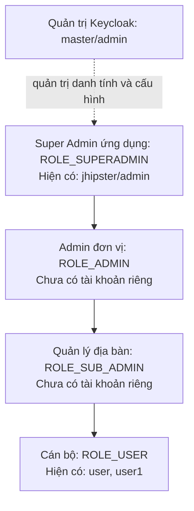
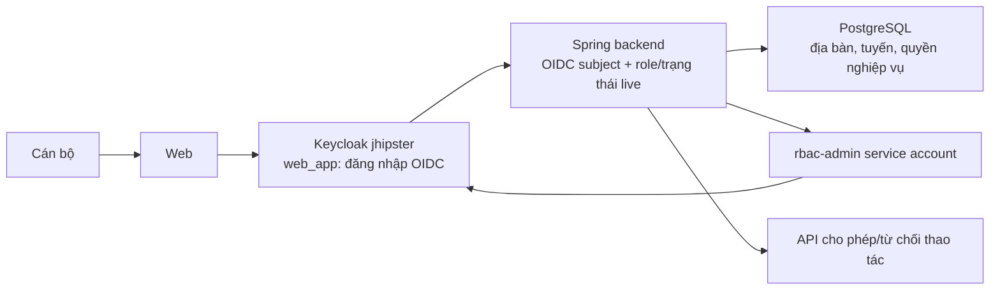

# Keycloak hiện tại: cấu trúc, tài khoản, cấu hình và lộ trình

Kiểm tra ngày 10/10/2026 bằng Admin CLI trên container đang chạy và đối chiếu mã nguồn. Đây là ảnh chụp cấu hình tại thời điểm kiểm tra, không phải cam kết trạng thái sau các lần thay đổi. Không thay đổi cấu hình realm trong lần đánh giá này.

## 1. Cấu trúc thực tế

```text
Keycloak — monolithic-keycloak-1 — image 26.7.4-0
├── realm master
│   └── admin: quản trị máy chủ Keycloak
└── realm jhipster: danh tính ứng dụng quản lý địa bàn
    ├── realm roles nghiệp vụ
    │   ├── ROLE_SUPERADMIN
    │   ├── ROLE_ADMIN
    │   ├── ROLE_SUB_ADMIN
    │   └── ROLE_USER
    ├── roles hệ thống
    │   ├── default-roles-jhipster (composite)
    │   ├── offline_access
    │   └── uma_authorization
    ├── groups
    │   ├── /Admins → ROLE_ADMIN
    │   └── /Users → ROLE_USER
    ├── users: admin, user, user1
    ├── clients ứng dụng: web_app, rbac-admin, jhipster-control-center
    ├── clients hệ thống: account, account-console, admin-cli,
    │   broker, realm-management, security-admin-console
    ├── clients kiểm thử còn lại: rbac-test-3d325bf9, rbac-test-76280cdf
    └── client scope jhipster → mapper roles / langKey / login
```

`admin` trong master và `admin` trong jhipster là hai danh tính thuộc hai realm khác nhau. Super Admin ứng dụng không mặc nhiên được quản trị Keycloak Console; quyền Console do role quản trị Keycloak quyết định.

Hai client kiểm thử còn tồn tại là phát hiện hiện tại; không có người dùng `rbac-test-*` trong danh sách kiểm tra. Chưa xóa chúng trong lần đánh giá chỉ đọc này.

### Tài khoản và cấp độ hiện có

| Tài khoản trong jhipster | Enabled | Group           | Realm roles nghiệp vụ hiệu lực         | Vai trò ứng dụng |
| ------------------------ | ------- | --------------- | -------------------------------------- | ---------------- |
| admin                    | true    | /Admins, /Users | ROLE_SUPERADMIN, ROLE_ADMIN, ROLE_USER | superadmin       |
| user                     | true    | /Users          | ROLE_USER                              | officer          |
| user1                    | true    | /Users          | ROLE_USER                              | officer          |

Cả ba chưa có required action. Chưa có tài khoản riêng mang vai trò admin đơn vị hay sub-admin trong snapshot này. Quyền nghiệp vụ/địa bàn của từng người không thể kết luận chỉ từ bảng Keycloak; xem `/api/rbac/me` hoặc menu phân quyền để đọc PostgreSQL.



Đây là thứ bậc quản lý do **backend ứng dụng** áp dụng. Bốn realm role hiện đều `composite=false`: Keycloak không tự tạo cây kế thừa SUPERADMIN → ADMIN → SUB_ADMIN → USER. Super Admin cũng có thể quản lý trực tiếp cấp dưới; admin có thể quản lý officer trong phạm vi, không bắt buộc qua sub-admin.

Khi đổi role qua ứng dụng, backend gán:

| Vai trò chọn | Direct realm roles backend gán           |
| ------------ | ---------------------------------------- |
| officer      | ROLE_USER                                |
| sub-admin    | ROLE_USER + ROLE_SUB_ADMIN               |
| admin        | ROLE_USER + ROLE_ADMIN                   |
| superadmin   | ROLE_USER + ROLE_ADMIN + ROLE_SUPERADMIN |

Backend chọn role cao nhất đang có. Role kế thừa từ group/composite vẫn có hiệu lực; đổi direct role không tự gỡ quyền do group cấp.

### Client và kết nối

| Client                             | Cấu hình đang chạy                                                     | Mục đích                                                               |
| ---------------------------------- | ---------------------------------------------------------------------- | ---------------------------------------------------------------------- |
| web_app                            | Public; Standard Flow ON; Direct Grants OFF; Service Account OFF       | Đăng nhập OIDC vào ứng dụng                                            |
| rbac-admin                         | Confidential; Standard Flow OFF; Direct Grants OFF; Service Account ON | Backend gọi Admin API để quản lý cán bộ                                |
| jhipster-control-center            | Public; Standard Flow ON                                               | Client có sẵn cho công cụ JHipster; chưa xác minh công cụ đang sử dụng |
| account / account-console          | Client hệ thống                                                        | Quản lý tài khoản cá nhân                                              |
| admin-cli / security-admin-console | Client hệ thống                                                        | CLI và Console quản trị                                                |
| broker / realm-management          | Client hệ thống                                                        | Hạ tầng liên kết danh tính và quyền quản trị realm                     |
| hai client rbac-test-*             | Public; Direct Grants ON                                               | Di sản kiểm thử, không dùng cho đăng nhập web thông thường             |

`rbac-admin` dùng `client-secret`; effective client roles của service account trong `realm-management` gồm `manage-users`, `view-users`, `query-users`, `view-realm`, `query-groups`. Script setup gán trực tiếp bốn role đầu; `query-groups` nằm trong tập hiệu lực đang đọc. Secret chỉ dành cho backend.

`web_app` có redirect URI localhost/127.0.0.1 nhiều cổng, một callback Postman, web origins `*`. PKCE S256 chưa được đặt bắt buộc ở cấu hình client. Spring có cấu hình mẫu client secret nhưng client live là public: không coi chuỗi secret mẫu là bằng chứng client đang confidential. Cần thống nhất mô hình client khi đưa production.

Client scope `jhipster` được gắn mặc định vào web_app. Mapper `roles`: realm role, multivalued, claim `roles`, đưa vào access token và UserInfo; không đưa vào ID token. Mapper `langKey`, `login` đưa vào UserInfo.



### Trạng thái realm

| Thiết lập                                   | Giá trị live                                |
| ------------------------------------------- | ------------------------------------------- |
| Enabled                                     | true                                        |
| User registration                           | false                                       |
| Login theme / locale                        | territory / vi                              |
| Verify email                                | false                                       |
| Forgot/reset password tự phục vụ            | false                                       |
| Brute force protection                      | false                                       |
| Password policy                             | chưa cấu hình                               |
| OTP policy type                             | totp; chưa chứng minh OTP bắt buộc          |
| SMTP                                        | chưa cấu hình host                          |
| User events / admin events                  | đều false                                   |
| Access token lifespan                       | 300 giây = 5 phút                           |
| SSO idle / max                              | 1.800 giây = 30 phút / 36.000 giây = 10 giờ |
| Identity providers                          | chưa có                                     |
| Authorization Services ở web_app/rbac-admin | không bật                                   |

Role `uma_authorization` có sẵn không có nghĩa các quyền nghiệp vụ đã dùng Authorization Services. Cấu hình `otpPolicyType=totp` cũng không có nghĩa mọi tài khoản đã đăng ký hoặc phải dùng OTP.

## 2. Cấu hình phù hợp với triển khai hiện tại

### Bước 1 — chọn đúng realm

Mở `http://localhost:9080/admin/`, đăng nhập quản trị Keycloak, chọn **jhipster**. Dùng master cho vận hành máy chủ; dùng jhipster cho cán bộ và client dự án. Không tạo tài khoản cán bộ trong master.

### Bước 2 — kiểm tra role

Trong Realm roles kiểm tra đúng bốn tên ROLE_USER, ROLE_SUB_ADMIN, ROLE_ADMIN, ROLE_SUPERADMIN. Không đổi tên khi backend còn dùng các tên này. Default composite hiện chỉ chứa offline_access và uma_authorization; không thêm ADMIN/SUPERADMIN vào default roles.

Trong Users → tài khoản → Role mapping, kiểm tra cả direct lẫn inherited roles. `/Admins` cấp ROLE_ADMIN; muốn hạ cấp người thuộc group này phải xử lý membership/role của group. Tránh sửa role của cả group để hạ cấp một người vì có thể ảnh hưởng các thành viên khác.

### Bước 3 — kiểm tra web_app

- Client ID giữ web_app, protocol OpenID Connect.
- Giữ Standard Flow ON và Direct Access Grants OFF cho đăng nhập trình duyệt.
- Gắn client scope jhipster, kiểm tra mapper roles đúng cấu hình snapshot.
- Kiểm tra redirect URI thực tế do Spring gửi. Khi production, chỉ cho phép URL callback của domain triển khai; không giữ wildcard toàn bộ localhost hoặc callback Postman.
- Mô hình hiện tại có Spring làm OAuth2 client: nếu chuyển sang confidential client, bật client authentication và đồng thời cấu hình secret thật ở Spring. Nếu giữ public client, cần cấu hình PKCE S256 và xác minh Spring gửi code challenge. Không đổi một phía rồi mặc định đăng nhập vẫn hoạt động.
- Backend kiểm tra audience account/api://default hiện tại. Thay audience cần thay mapper/token và validator cùng nhau, có kiểm thử token thật.

### Bước 4 — kiểm tra rbac-admin

- Client authentication ON, Service accounts ON.
- Standard Flow, Direct Access Grants OFF.
- Service account roles: chọn client realm-management, kiểm tra các role script đã gán.
- Credentials: lấy secret vào secret store môi trường. Local dùng `.rbac/keycloak.properties`, file đã gitignore. Không dán secret vào docs, code React hay localStorage.
- Backend cần issuer đúng và `RBAC_KEYCLOAK_CLIENT_ID`, `RBAC_KEYCLOAK_CLIENT_SECRET` tương ứng nếu dùng biến môi trường.

Script tái lập local sau khi CLI đã đăng nhập:

```powershell
powershell -NoProfile -ExecutionPolicy Bypass -File scripts/setup-rbac.ps1 -BootstrapUser admin
```

Script dùng realm jhipster, container mặc định monolithic-keycloak-1; có tham số -Container. Nó tạo role/client nếu chưa có, gán quyền service account, lấy secret và bootstrap một tài khoản hiện hữu. Nó không tạo đủ tài khoản cho mọi cấp, không cấu hình MFA/SMTP và không đồng bộ địa bàn vào Keycloak.

### Bước 5 — tạo tài khoản theo cấp

Ưu tiên tạo bằng Super Admin Hub để đồng bộ hồ sơ nghiệp vụ. Nếu tạo trực tiếp bằng Console: Users → Add user, nhập username/họ tên/email, bật Enabled; Credentials đặt mật khẩu temporary; Role mapping chọn vai trò phù hợp. Tiếp đó vào ứng dụng để phân công ID địa bàn và quyền nghiệp vụ. Chỉ tạo role ở Keycloak chưa đủ để cán bộ đọc/ghi dữ liệu.

Tài khoản admin đơn vị mới cần ROLE_ADMIN và ROLE_USER; quản lý địa bàn cần ROLE_SUB_ADMIN và ROLE_USER. Super Admin cần thêm ROLE_ADMIN để tương thích các trang quản trị JHipster. Không dùng chung tài khoản admin cho toàn bộ cán bộ.

### Bước 6 — kiểm tra hai phía

1. Keycloak: tài khoản Enabled, role hiệu lực, group, Credentials/required actions đúng.
2. Ứng dụng: `/api/rbac/me` trả đúng subject, role, areaZoneIds, assignedStreets, subAdminPermissions.
3. Cán bộ chưa được giao địa bàn không thấy hồ sơ.
4. Tài khoản khác địa bàn không đọc theo ID hoặc xuất CSV ngoài phạm vi.
5. Đổi role/khóa: request sau phải bị thu hồi quyền theo cấu hình hiện tại, kể cả token cũ.
6. Admin/sub-admin không cấp quyền ngoài phạm vi mình, không tự tăng quyền.

## 3. Keycloak còn làm được gì cho dự án?

Keycloak hỗ trợ OTP/WebAuthn, liên kết LDAP/AD, kết nối nhà cung cấp OIDC/SAML, quản lý phiên, nhóm và sự kiện. Những khả năng này bổ sung bảo vệ danh tính và SSO, chưa tự thay thế kiểm tra hồ sơ theo địa bàn ở backend. [Tài liệu quản trị Keycloak](https://www.keycloak.org/docs/latest/server_admin/index.html).

| Ưu tiên | Khả năng                       | Ứng dụng cho dự án và việc cần làm                                                                                       |
| ------- | ------------------------------ | ------------------------------------------------------------------------------------------------------------------------ |
| P0      | Cấu hình production            | Thay start-dev/dev-file bằng triển khai production, DB bền vững, HTTPS, hostname, backup, secret môi trường              |
| P0      | Giảm bề mặt truy cập           | Giới hạn callback/origin; rà soát client kiểm thử; bảo vệ đường quản trị; thống nhất public/confidential và PKCE         |
| P1      | MFA                            | Đề xuất bắt buộc cho superadmin/admin trước; TOTP hoặc khóa bảo mật; kiểm thử đăng ký, đăng nhập và khôi phục            |
| P1      | Chống dò mật khẩu              | Bật brute-force protection và password policy; giá trị ngưỡng cần phù hợp vận hành, tránh khóa cán bộ hàng loạt          |
| P1      | Nhật ký danh tính              | Bật user/admin events với retention; kết hợp audit nghiệp vụ PostgreSQL, không ghi mật khẩu/token vào log                |
| P1      | SMTP                           | Cấu hình email xác minh và khôi phục mật khẩu; kiểm thử gửi. Email nhắc nhở hồ sơ vẫn cần worker/dịch vụ nghiệp vụ riêng |
| P2      | Nhóm tổ chức                   | Nhóm theo thành phố/xã-phường/đơn vị để quản lý danh tính; không tự cấp địa bàn DB chỉ vì tham gia group                 |
| P2      | SSO nhiều ứng dụng             | Client riêng cho web, ứng dụng di động, cổng báo cáo; chia sẻ realm, không chia sẻ secret giữa client                    |
| P2      | LDAP/AD hoặc SSO cơ quan       | Kết nối hệ thống danh tính đã có khi được đơn vị cung cấp; kiểm soát lifecycle chuyển công tác/nghỉ việc                 |
| P2      | Giới hạn quyền service account | Đánh giá quyền quản trị chi tiết phù hợp phiên bản để giảm quyền manage-users; kiểm thử đầy đủ trước thay quyền          |
| P3      | Xác thực nâng mức              | Yêu cầu xác thực bổ sung cho xuất dữ liệu/đổi quyền; cần backend kiểm tra mức xác thực, không chỉ thêm bước UI           |
| P3      | Authorization Services         | Có thể tập trung hóa permission cho nhiều ứng dụng; cần thiết kế resource/scope/policy và backend thực thi quyết định    |

Keycloak Authorization Services cung cấp resources, scopes, policies và permissions; bật chức năng này không tự bảo vệ API đã có. Dự án phải tích hợp việc yêu cầu và thực thi quyết định, cùng cách cập nhật quyền. [Authorization Services Guide](https://www.keycloak.org/docs/latest/authorization_services/index.html).

**Đề xuất kiến trúc:** hiện giữ quyền chi tiết và phạm vi hồ sơ tại PostgreSQL/backend. Địa bàn và dữ liệu dân cư gắn quan hệ DB nên cách này dễ kiểm tra danh sách/count/export nhất. Chỉ cân nhắc chuyển permission sang Keycloak khi nhiều hệ thống thực sự cần chung một chính sách; không lưu song song hai bản quyền có thể sửa độc lập.

Các role hiện tại là chức năng quản trị, không mã hóa cấp hành chính. Nếu mở rộng thành phố → xã/phường → khu vực, cần mô hình đơn vị/địa bàn có quan hệ cha-con trong DB và quy tắc phạm vi backend. Group Keycloak có thể hỗ trợ tổ chức danh tính, nhưng hiện chưa có đồng bộ group → areaZoneIds.

## 4. Lưu ý production từ hiện trạng

Compose hiện dùng start-dev, KC_DB=dev-file và không mount volume dữ liệu Keycloak bền vững; PostgreSQL nghiệp vụ không phải DB của Keycloak. Tái tạo container có thể mất những thay đổi live ngoài realm import. Cần DB riêng/schema phù hợp cho Keycloak và kế hoạch backup/restore trước khi triển khai thật.

Keycloak khuyến nghị HTTPS, hostname/proxy đúng, DB phù hợp production và bảo vệ giao diện/API quản trị. [Hướng dẫn production](https://www.keycloak.org/server/configuration-production).

Không áp dụng thay đổi bảo mật hàng loạt khi chưa có tài khoản vận hành dự phòng và kiểm thử đăng nhập. Đây là yêu cầu kỹ thuật của lộ trình đề xuất, không phải các tính năng đã bật trong snapshot.

## 5. Điểm mã nguồn cần đọc

- `src/main/docker/keycloak.yml`: runtime, port, theme, import realm.
- `src/main/docker/realm-config/jhipster-realm.json`: cấu hình khởi tạo; không đại diện đầy đủ cho mọi thay đổi live.
- `scripts/setup-rbac.ps1`: bootstrap role/client/service account.
- `service/rbac/KeycloakAdminClient.java`: đọc role hiệu lực, đổi role, khóa và đăng xuất.
- `service/rbac/RbacService.java`: kết hợp danh tính với phân công DB.
- `config/RbacWebConfiguration.java`: kiểm tra live role/trạng thái, whitelist và IP.
- `security/SecurityUtils.java`: mapper authorities hiện ưu tiên claim groups nếu có, rồi mới roles. Khi bổ sung mapper groups theo tổ chức, cần sửa/kiểm thử quy tắc này để không vô tình làm mất authorities ROLE_*.
- `docs/rbac-keycloak-van-hanh.md`: vận hành quyền chi tiết và hồ sơ cũ.
