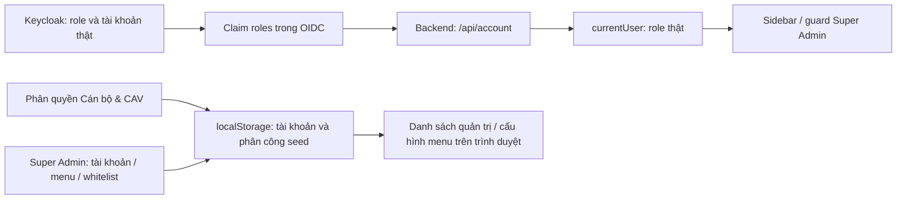
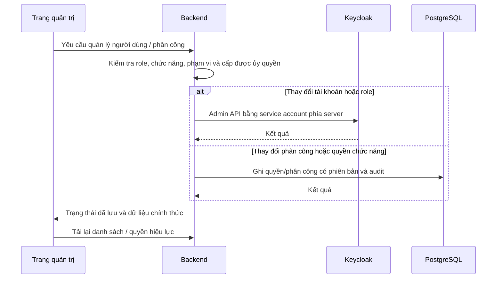

# Keycloak RBAC: hiện trạng, cách sử dụng và thiết kế đồng bộ

> Tài liệu đánh giá trước triển khai. Hướng dẫn hiện hành và chức năng đã thực hiện nằm tại [RBAC và Keycloak: vận hành](rbac-keycloak-van-hanh.md).

Ngày kiểm tra: 09/10/2026. Phạm vi: mã nguồn checkout, cấu hình Keycloak đang chạy tại cổng 9080, truy cập API không đăng nhập tại cổng 8080 và các test được nêu bên dưới.

## 1. Kết luận

**RBAC hiện hoạt động một phần: đã có đăng nhập và ánh xạ vai trò từ Keycloak vào dashboard; chưa có đồng bộ quản trị tài khoản, quyền chức năng và phân công địa bàn giữa Keycloak, menu Phân quyền Cán bộ & CAV và trang Super Admin.**

Không thể chỉ cấu hình Keycloak để các nút phân quyền hiện tại trở thành chức năng backend. Cần thay lớp lưu cục bộ bằng API và thực thi quyền ở server.

| Nội dung                                       | Trạng thái và bằng chứng                                                                                                 |
| ---------------------------------------------- | ------------------------------------------------------------------------------------------------------------------------ |
| OAuth2/OIDC → backend                          | Có cấu hình xác thực và ánh xạ claim `roles`/`groups`                                                                    |
| Backend → vai trò dashboard                    | `mapAccountToGisUser()` lấy quyền từ `/api/account`; 3 test ánh xạ/không tin localStorage đã đạt                         |
| Chặn API khi chưa đăng nhập                    | API account, households, residents, area-zones đang chạy trả HTTP 401 khi không có phiên                                 |
| Bảo vệ CSRF cho session                        | Test filter chain production xác nhận yêu cầu ghi thiếu CSRF bị từ chối                                                  |
| Quyền quản trị JHipster                        | `/api/admin/**`, management không công khai và route React admin cần `ROLE_ADMIN`; khác quyền vào Super Admin Hub        |
| Loại nhà GIS                                   | API cập nhật có `@PreAuthorize` cho `ROLE_ADMIN` hoặc `ROLE_SUPERADMIN`                                                  |
| Role trong Keycloak đang chạy                  | Có `ROLE_USER`, `ROLE_ADMIN`; chưa có `ROLE_SUB_ADMIN`, `ROLE_SUPERADMIN`                                                |
| Menu theo role                                 | Sidebar lọc `visibleRoles` theo role tài khoản; cấu hình menu lấy từ seed/localStorage                                   |
| Menu Phân quyền Cán bộ & CAV                   | Nút lưu gọi `saveUserInFirestore()`, thực tế ghi `cskv_app_users` trong localStorage                                     |
| Super Admin quản lý tài khoản                  | Tạo/sửa/xóa/khóa trong danh sách cục bộ, chưa gọi Keycloak Admin API                                                     |
| Quyền chức năng và địa bàn của người đăng nhập | Mapper account không đọc các quyền này, trả `assignedHamlets: []`, `assignedStreets: []`, không có `subAdminPermissions` |
| Phân quyền dữ liệu backend                     | Chưa có chính sách đầy đủ theo cán bộ/địa bàn; API nghiệp vụ chủ yếu yêu cầu authenticated                               |
| Whitelist email, blacklist IP                  | Lớp quản trị hiện lưu cục bộ; không chứng minh có cơ chế chặn đăng nhập hoặc firewall ở server                           |

Test đã chạy: `backendSession.spec.ts` 3/3 đạt; `GisSecurityTest` 7/7 và `SecurityUtilsUnitTest` 10/10 đạt. Các test Java dùng mock/probe, không chứng minh đủ quyền chức năng, quyền từng bản ghi hoặc đăng nhập thực tế ở cả bốn vai trò. Chưa kiểm tra trực quan menu hay đăng nhập xuyên suốt với bốn tài khoản phân quyền riêng.

## 2. Vì sao phân quyền trên màn hình chưa có hiệu lực đầy đủ?

Hiện có hai luồng tách biệt:



Ví dụ: đổi cán bộ thành Super Admin trong danh sách cục bộ **không cấp** `ROLE_SUPERADMIN` cho tài khoản Keycloak. Khóa người dùng trên màn này cũng chưa khóa tài khoản Keycloak.

Phân công một cán bộ vào Ấp A trên màn hình chưa cập nhật `currentUser` từ `/api/account`. Khi `assignedHamlets` rỗng, `matchesHamlet()` hiện trả `true`; chuyển chế độ “all” cũng dùng toàn bộ hộ đã tải. Đây là bộ lọc giao diện, chưa phải giới hạn quyền dữ liệu.

Các kiểm tra như `canAddHouseholds === false` chỉ chặn khi quyền bị đặt rõ là false. Vì account mapper chưa trả `subAdminPermissions`, nhiều kiểm tra không chặn. Thay quyền cục bộ không giải quyết được kiểm soát API.

## 3. Cách sử dụng Keycloak ngay với dự án này

### 3.1. Vai trò phải đúng tên

| Realm role        | Role GIS     | Tác dụng giao diện hiện có                                   |
| ----------------- | ------------ | ------------------------------------------------------------ |
| `ROLE_USER`       | `officer`    | Các menu nghiệp vụ mặc định cho cán bộ                       |
| `ROLE_SUB_ADMIN`  | `sub-admin`  | Các menu nghiệp vụ và phân quyền theo cấu hình mặc định      |
| `ROLE_ADMIN`      | `admin`      | Menu phân quyền, quản trị JHipster và các endpoint cần ADMIN |
| `ROLE_SUPERADMIN` | `superadmin` | Super Admin Hub, ưu tiên cao nhất trong mapper GIS           |

Thứ tự chọn một role hiển thị: superadmin → admin → sub-admin → officer. Các authority vẫn là tập quyền; ví dụ tài khoản có `ROLE_ADMIN` và `ROLE_SUB_ADMIN` sẽ hiển thị là admin.

Quyền `admin` ở realm `master` để quản trị Keycloak không tự trở thành `ROLE_ADMIN` của ứng dụng ở realm `jhipster`. Tài khoản seed `superadmin`, `truong_cax`, `cskv_ap1`… trong frontend không có nghĩa chúng tồn tại ở Keycloak. Lần kiểm tra này Keycloak liệt kê các username `admin`, `user`, `user1`.

### 3.2. Tạo và cấp vai trò

Trong Admin Console tại `http://localhost:9080/admin/`:

1. Chọn realm **jhipster**.
2. **Realm roles → Create role**: tạo hai role còn thiếu `ROLE_SUB_ADMIN`, `ROLE_SUPERADMIN`.
3. **Users → Add user**, bật Enabled; **Credentials → Set password**. Chọn Temporary khi cần đổi mật khẩu lần đầu.
4. **Users → Role mapping → Assign role**, chọn Realm roles và role cần cấp.
5. **Groups → Role mapping** nếu cấp theo nhóm; người dùng nhận role qua nhóm. [Keycloak Administration Guide](https://www.keycloak.org/docs/26.7.0/server_admin/index.html).

Nhóm đang có: `Admins` mang `ROLE_ADMIN`, `Users` mang `ROLE_USER`. Có thể giữ nhóm này và thêm nhóm phân loại chức vụ riêng. Tên nhóm như `SubAdmins` không tự ánh xạ thành quyền; role gắn vào nhóm mới quyết định.

Đề xuất tổ hợp để tương thích các route hiện tại:

| Tài khoản thử nghiệm             | Role cấp                                       |
| -------------------------------- | ---------------------------------------------- |
| Cán bộ                           | `ROLE_USER`                                    |
| Cán bộ quản lý địa bàn           | `ROLE_USER` + `ROLE_SUB_ADMIN`                 |
| Quản trị xã/phường               | `ROLE_USER` + `ROLE_ADMIN`                     |
| Super Admin có quản trị JHipster | `ROLE_USER` + `ROLE_ADMIN` + `ROLE_SUPERADMIN` |

`ROLE_USER` bổ sung phục vụ route entity CRUD đang yêu cầu USER; `ROLE_ADMIN` bổ sung cho trang JHipster admin. Nếu Super Admin không cần trang quản trị JHipster, không tự động cấp ADMIN. Đây là cách tương thích checkout hiện tại, chưa phải mô hình quyền nghiệp vụ cuối cùng.

### 3.3. Kiểm tra mapper của dự án

Trong **Client scopes → jhipster → Mappers → roles**, đối chiếu cấu hình đã đọc từ server:

| Cấu hình            | Giá trị hiện tại |
| ------------------- | ---------------- |
| Mapper type         | User Realm Role  |
| Token Claim Name    | `roles`          |
| Multivalued         | On               |
| Claim JSON Type     | String           |
| Add to access token | On               |
| Add to userinfo     | On               |
| Add to ID token     | Off              |

Client `web_app` hiện có scope `jhipster` trong default scopes và `fullScopeAllowed: true`. Với đăng nhập session, mapper Spring hiện đọc authority từ **UserInfo**, nên `Add to userinfo` là điểm cần giữ. Không cần bật ID token chỉ để sửa luồng đang có.

`SecurityUtils` không trực tiếp đọc role trong `realm_access.roles` hoặc `resource_access`. Nó đọc `groups`, rồi `roles`, rồi claim namespaced của JHipster. **Không thêm mapper group membership ghi vào `groups` mà không điều chỉnh backend**: nếu `groups` tồn tại với đường dẫn nhóm như `/Admins`, code sẽ ưu tiên nó và có thể bỏ qua claim `roles`. Khi đó lọc `ROLE_` không tìm thấy vai trò mong muốn.

Sau thay đổi role, đăng xuất ứng dụng rồi đăng nhập lại từ `/dashboard`. Chỉ tải lại trang có thể giữ authority trong phiên cũ. Trường hợp thu hồi quyền cần chính sách kết thúc phiên phía ứng dụng và xử lý token còn hiệu lực; không mặc định đổi role tại Keycloak thu hồi ngay mọi session Spring đang mở.

### 3.4. Kiểm tra tài khoản trong ứng dụng

Mở `/api/account` trong cùng trình duyệt đã đăng nhập, hoặc xem response Network. Kiểm tra:

```json
{
  "login": "canbo-thu-nghiem",
  "activated": true,
  "authorities": ["ROLE_USER", "ROLE_SUB_ADMIN"]
}
```

Đây là ví dụ mong đợi, không phải response của một tài khoản đã tạo trong lần khảo sát.

Nếu role đúng ở Keycloak nhưng không xuất hiện trong account: kiểm tra realm, client `web_app`, mapper `roles`, default client scopes, role kế thừa từ nhóm và đăng nhập mới. Nếu account đã có role đúng mà menu không xuất hiện: kiểm tra `visibleRoles` của menu và cache menu cục bộ, không sửa account bằng localStorage.

Hiện có thể dùng Keycloak để cấp quyền mở menu theo role. **Không dùng việc thấy menu làm bằng chứng đã hạn chế được đọc/ghi hộ dân hoặc phân công địa bàn.**

## 4. Thiết kế cần bổ sung để đồng bộ hai trang quản trị

### 4.1. Chốt một nguồn chính thức cho từng loại dữ liệu

| Dữ liệu                                          | Nguồn chính thức đề xuất      | Trang thực hiện                                         |
| ------------------------------------------------ | ----------------------------- | ------------------------------------------------------- |
| Định danh OIDC, login, mật khẩu, Enabled, MFA    | Keycloak                      | Super Admin gọi backend; backend gọi Admin API          |
| Role cấp cao USER/SUB_ADMIN/ADMIN/SUPERADMIN     | Keycloak                      | Super Admin hoặc quản trị được ủy quyền theo chính sách |
| Hồ sơ cán bộ, số hiệu, đơn vị                    | PostgreSQL                    | Quản trị cán bộ                                         |
| Phân công xã/phường/ấp/tuyến, thời gian hiệu lực | PostgreSQL                    | Phân quyền Cán bộ & CAV                                 |
| Quyền chức năng cụ thể                           | PostgreSQL và policy backend  | Phân quyền Cán bộ & CAV                                 |
| Cấu hình menu toàn hệ thống                      | PostgreSQL qua API            | Super Admin                                             |
| Quyền hiệu lực cho phiên hiện tại                | Backend tổng hợp từ OIDC + DB | Mọi màn nghiệp vụ                                       |

Liên kết bằng định danh OIDC ổn định `(issuer, sub)`, không dùng `USR-*` seed, email hoặc họ tên làm định danh bảo mật. Account hiện có ID của người dùng JHipster nhưng cần xác nhận quy tắc liên kết và bổ sung dữ liệu hồ sơ, không ép ghép với danh sách cục bộ.

Keycloak chịu trách nhiệm xác thực và role. Backend chịu trách nhiệm chính sách **vai trò + chức năng + đơn vị/địa bàn + bản ghi**. Đưa tên ấp vào user attribute Keycloak không tự tạo bộ lọc tại API.

### 4.2. Luồng đồng bộ đề xuất



Không gửi token quản trị, client secret hoặc thông tin quản trị `master` xuống frontend. Tạo service account riêng cho tích hợp, chỉ cấp khả năng quản lý user/role cần thiết trong realm `jhipster`. Chốt quyền Admin API cụ thể sau khi xác định thao tác và phiên bản Keycloak; không mặc định cấp `realm-admin` cho toàn bộ chức năng.

Keycloak và PostgreSQL không cùng một giao dịch. Tạo tài khoản + hồ sơ cần trạng thái provisioning, xử lý thất bại từng bước, retry idempotent và đối chiếu; chỉ báo hoàn tất khi các bước bắt buộc đều thành công. Đồng bộ cả thay đổi từ Keycloak Admin Console bằng refresh/reconciliation hoặc cơ chế sự kiện có kiểm soát.

### 4.3. Các API đề xuất, chưa tồn tại

| API dự kiến                           | Trách nhiệm                                                        |
| ------------------------------------- | ------------------------------------------------------------------ |
| `GET /api/rbac/me`                    | Trả hồ sơ, roles, permissions, scope và version quyền hiện tại     |
| `GET /api/rbac/users`                 | Danh sách cán bộ từ nguồn chính thức, giới hạn theo người quản trị |
| `POST /api/rbac/users`                | Provision tài khoản Keycloak và hồ sơ DB                           |
| `PUT /api/rbac/users/{id}/roles`      | Cấp/thu hồi role trong danh mục cho phép                           |
| `PUT /api/rbac/users/{id}/status`     | Khóa/mở tài khoản thật, xử lý thu hồi phiên                        |
| `PUT /api/rbac/users/{id}/delegation` | Lưu phạm vi và quyền chức năng trong DB                            |
| `GET /api/rbac/menus`                 | Menu được phép từ policy backend và cấu hình dùng chung            |
| `PUT /api/rbac/menus`                 | Cập nhật cấu hình menu bởi người được phép                         |

Đây là thiết kế tham khảo, không phải endpoint có thể gọi ngay. API cấp quyền phải ngăn tự nâng quyền, cấp quyền cao hơn người cấp, cấp ra ngoài đơn vị và thao tác trực tiếp qua ID để vượt quyền. Chính sách ai được cấp ADMIN/SUPERADMIN phải tách khỏi quyền chỉnh địa bàn của cán bộ.

### 4.4. Thay đổi frontend cần có

- Thay `saveUserInFirestore`, `deleteUserInFirestore`, `updateOfficerPermissions` và các thao tác menu bằng API có báo lỗi rõ.
- Thay danh sách seed trong hai trang quản trị bằng danh sách cán bộ thật; không merge lại tài khoản mẫu sau mỗi lần mở dashboard.
- Giữ `mapAccountToGisUser()` lấy role từ backend; bổ sung hồ sơ/phân công/quyền từ endpoint chính thức, tuyệt đối không lấy role từ cache cục bộ.
- Sidebar và các nút dùng chung policy hiệu lực. Không có quyền thì mặc định không cho; chưa tải policy phải hiện trạng thái tải/lỗi.
- Khi lưu phân quyền, tải lại dữ liệu server và version. Người dùng khác nhận quyền mới qua refetch có kiểm soát hoặc sự kiện; frontend cập nhật menu nhưng server vẫn là nơi quyết định.
- Trang Super Admin chỉ hiển thị “đã khóa tài khoản” sau xác nhận của hệ thống định danh; phân biệt danh sách whitelist tham khảo với chính sách đăng nhập đã thực thi.

### 4.5. Backend cần bảo vệ gì?

Mọi list/search/count/chi tiết/sửa/xóa/xuất/bản đồ phải chịu scope server. Không dựa vào `areaZoneId.equals` do client gửi hoặc tên ấp so khớp gần đúng. Hộ mới phải thuộc địa bàn người dùng được phép; cư dân kế thừa quyền từ hộ và phải kiểm tra khi chuyển hộ.

Thiếu phân công phải từ chối hoặc trả tập rỗng theo policy, không tự mở toàn bộ dữ liệu. Quyền như sửa tọa độ và sửa hồ sơ phải tách nếu nghiệp vụ cần; một PATCH chung phải kiểm tra từng trường nhạy cảm. Cấp quyền chức năng trên menu không đủ nếu API hoặc DTO vẫn cho thao tác tương ứng.

Audit quyền phải do server ghi: người cấp, người nhận, quyền/phạm vi trước–sau, thời điểm, kết quả. Chốt cơ chế vô hiệu phiên ứng dụng, cache policy và thời gian thu hồi tối đa khi khóa user hoặc đổi role.

## 5. Kịch bản nghiệm thu tích hợp

| Kịch bản                            | Kết quả bắt buộc                                                                          |
| ----------------------------------- | ----------------------------------------------------------------------------------------- |
| Cán bộ chỉ có USER                  | Không thấy trang quản trị; gọi API quản trị trực tiếp bị từ chối                          |
| SUB_ADMIN quản lý một địa bàn       | Chỉ quản lý cán bộ/hồ sơ trong phạm vi; không tự cấp ADMIN/SUPERADMIN                     |
| ADMIN trong một đơn vị              | Không chỉnh cán bộ/địa bàn đơn vị khác bằng cách đổi ID                                   |
| SUPERADMIN                          | Vào Hub theo role; thao tác lưu cập nhật dữ liệu server và audit                          |
| Tạo cán bộ ở Hub                    | Tài khoản xuất hiện ở Keycloak và hồ sơ DB, có thể đăng nhập theo quy trình cấp tài khoản |
| Khóa cán bộ ở Hub                   | Keycloak Disabled; phiên/token/quyền hiện tại được xử lý đúng chính sách thu hồi          |
| Tắt quyền sửa tọa độ                | Menu/nút phản ánh policy; API sửa tọa độ trả 403 dù gọi trực tiếp                         |
| Phân công Ấp A                      | API hộ/cư dân chỉ trả dữ liệu hợp lệ; ID của Ấp B bị từ chối                              |
| Chưa phân công                      | Không nhận toàn bộ dữ liệu                                                                |
| Lưu ở thiết bị thứ nhất             | Thiết bị thứ hai tải lại nhận cùng cấu hình quyền/menu                                    |
| Đổi role trong Admin Console        | Đăng nhập mới và reconciliation phản ánh role chính thức                                  |
| Keycloak/DB lỗi khi provision       | Không báo thành công sai; có trạng thái lỗi và retry không tạo trùng                      |
| Sửa localStorage / gọi API ngoài UI | Không nâng quyền hoặc vượt phạm vi                                                        |

## 6. Tác vụ tiếp theo đề xuất

Goal phù hợp: **“Đồng bộ tài khoản và phân quyền giữa Keycloak, Phân quyền Cán bộ & CAV và Super Admin, thực thi policy tại backend.”**

Triển khai theo thứ tự: chốt ma trận quyền → hồ sơ/phân công DB và API quyền hiệu lực → bảo vệ API nghiệp vụ → tích hợp Admin API Keycloak → thay lưu cục bộ ở hai trang → test chéo vai trò/địa bàn/thiết bị và thu hồi phiên. Không chỉ nối danh sách tài khoản vào giao diện rồi coi RBAC đã hoàn tất.

Trong lần kiểm tra này chỉ đọc cấu hình và chạy test, **chưa tạo role/tài khoản, cấp quyền cho người dùng hoặc triển khai các API đồng bộ đề xuất**.

## 7. Căn cứ mã nguồn và lệnh kiểm tra

- `src/main/java/com/policemanagement/com/config/SecurityConfiguration.java`: filter chain và mapper OIDC UserInfo.
- `src/main/java/com/policemanagement/com/security/SecurityUtils.java`: các claim được nhận, lọc `ROLE_`.
- `src/main/java/com/policemanagement/com/service/UserService.java`: đồng bộ người đăng nhập từ IdP vào DB; không đồng bộ ngược danh sách quản trị localStorage.
- `src/main/webapp/app/gis/services/backendSession.ts`: role và profile của người đang đăng nhập.
- `src/main/webapp/app/gis/services/authService.ts`: lớp lưu cục bộ của quản trị.
- `src/main/webapp/app/gis/components/SubAdminDelegationTab.tsx`, `SuperAdminHubTab.tsx`, `Sidebar.tsx`, `gis/App.tsx`: thao tác phân quyền/menu và nơi kiểm tra quyền giao diện.

```powershell
node node_modules/vitest/vitest.mjs run src/main/webapp/app/gis/services/backendSession.spec.ts
.\mvnw.cmd '-Dskip.installnodenpm' '-Dskip.npm' '-Dtest=GisSecurityTest,SecurityUtilsUnitTest' test
docker exec monolithic-keycloak-1 /opt/keycloak/bin/kcadm.sh get roles -r jhipster --fields name
```

Lệnh kcadm cần phiên quản trị còn hiệu lực; dùng hướng dẫn đăng nhập CLI tại [tài liệu theme](keycloak-login-theme.md) nếu cần. Không in token, mật khẩu hoặc thông tin hồ sơ nhạy cảm vào log khi kiểm tra.
