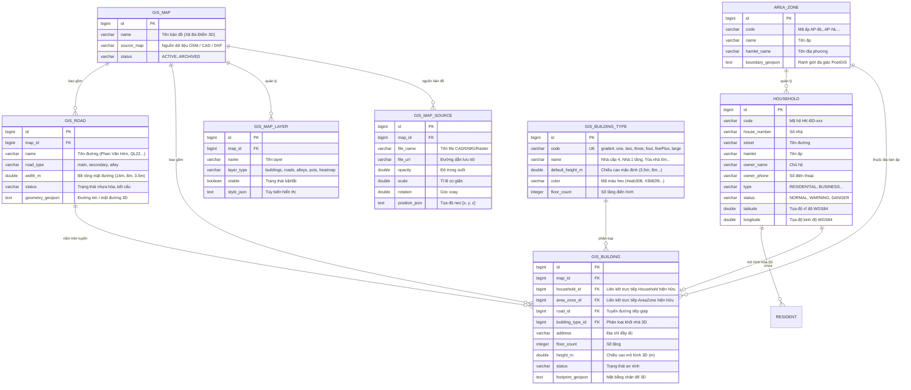

# Thiết kế Mô hình Cơ sở Dữ liệu Bản đồ Không gian 3D (Xã Bà Điểm, TP.HCM)

Tài liệu này đặc tả kiến trúc cơ sở dữ liệu và ánh xạ thực thể phục vụ hệ thống **Bản đồ Không gian 3D Three.js** cho toàn bộ địa bàn **Xã Bà Điểm, Huyện Hóc Môn, TP. Hồ Chí Minh**.

Tuân thủ nguyên tắc: **Tái sử dụng tối đa các thực thể đã có (`Household`, `AreaZone`, `Resident`, `PatrolLog`, `SecurityAlert`), KHÔNG tạo trùng lặp dữ liệu**.

---

## 1. Sơ đồ Quan hệ Thực thể (ER Diagram)

---

## 2. Bảng Tái Sử Dụng Thực Thể (Entity Reuse Matrix)

| Thực thể nghiệp vụ | Thực thể trong DB hiện hữu | Cơ chế tái sử dụng | Ghi chú |
|---|---|---|---|
| **Hộ gia đình / Cơ sở** | `household` | Sử dụng nguyên vẹn ID, mã hộ, số nhà, chủ hộ, nhân khẩu, tình trạng ANTT, tọa độ GPS `latitude` / `longitude`. | Khối 3D `gis_building` trỏ khóa ngoại `household_id` về bảng này. Không lưu lặp lại thông tin chủ hộ. |
| **Khu vực / Ấp dân cư** | `area_zone` | Tái sử dụng bảng `area_zone` với trường `boundary_geojson` và thông tin CSKV phụ trách ấp. | `gis_building` liên kết `area_zone_id` để phân loại theo ấp. |
| **Cư dân / Nhân khẩu** | `resident` | Giữ nguyên quan hệ 1-N với `household`. | Click vào nhà 3D có thể xem danh sách nhân khẩu mà không cần bảng phụ. |
| **Nhật ký tuần tra & Cảnh báo** | `patrol_log`, `security_alert` | Giữ nguyên phục vụ kiểm tra thực địa và cảnh báo an ninh. | Layer Heatmap 3D truy vấn mật độ cảnh báo từ bảng này. |

---

## 3. Bảng Mở Rộng Dành Riêng cho Bản Đồ 3D (New Spatial Tables)

Các bảng này đã được thiết kế sẵn trong Liquibase Migration:
`src/main/resources/config/liquibase/changelog/20261008190000_gis_3d_model.xml`.

### 3.1. `gis_map` (Bản đồ khu vực)
- `id` (bigint, PK)
- `name` (varchar(255)): Tên bản đồ (ví dụ: "Bản đồ không gian 3D Xã Bà Điểm")
- `source_map` (varchar(255)): Nguồn bản đồ nền
- `status` (varchar(32)): Trạng thái (`ACTIVE`, `DRAFT`)

### 3.2. `gis_building_type` (Phân loại chiều cao & màu sắc nhà - Admin có thể tùy biến)
- `id` (bigint, PK)
- `code` (varchar(40), UK): `grade4`, `one`, `two`, `three`, `four`, `fivePlus`, `large`
- `name` (varchar(120)): Tên hiển thị (Nhà cấp 4, Nhà 1 tầng, Nhà 2 tầng, Nhà 3 tầng, Nhà 4 tầng, Nhà 5+ tầng, Tòa nhà lớn)
- `default_height_m` (double): Chiều cao mặc định tính bằng mét (3.5m, 4.5m, 8.0m, 11.5m, 15.0m, 19.0m, 24.0m)
- `color` (varchar(9)): Mã màu hex (#eab308, #3b82f6, #10b981, #f97316, #ef4444, #8b5cf6, #ec4899)
- `floor_count` (integer): Số tầng tương ứng

### 3.3. `gis_road` (Mạng lưới đường giao thông 3D)
- `id` (bigint, PK)
- `map_id` (bigint, FK -> `gis_map`)
- `external_id` (varchar(120)): Mã tuyến đường (ví dụ: `RD-BD-PVH`)
- `name` (varchar(255)): Tên đường (ví dụ: "Đường Phan Văn Hớn", "Đường Quốc Lộ 22")
- `road_type` (varchar(32)): `main` (Đường chính), `secondary` (Đường phụ), `alley` (Hẻm/ngõ)
- `width_m` (double): Bề rộng mặt đường tính bằng mét (14m, 8m, 4m...)
- `status` (varchar(40)): Tình trạng hạ tầng ("Mặt đường nhựa hoàn thiện tốt")
- `geometry_geojson` (clob / text): Tọa độ chuỗi điểm 3D dạng GeoJSON LineString / Polygon ribbon

### 3.4. `gis_building` (Mô hình khối nhà 3D)
- `id` (bigint, PK)
- `map_id` (bigint, FK -> `gis_map`)
- `household_id` (bigint, FK -> `household` - có thể null nếu là công trình phụ trợ)
- `area_zone_id` (bigint, FK -> `area_zone` - ấp quản lý)
- `road_id` (bigint, FK -> `gis_road` - tuyến đường tiếp giáp)
- `building_type_id` (bigint, FK -> `gis_building_type`)
- `address` (varchar(255)): Địa chỉ số nhà và tên đường
- `floor_count` (integer): Số tầng thực tế
- `height_m` (double): Chiều cao khối hộp 3D thực tế
- `status` (varchar(40)): Tình trạng an ninh (`normal`, `warning`, `alert`, `business`)
- `footprint_geojson` (clob / text): Đa giác chân đế nhà (footprint m²)

### 3.5. `gis_map_layer` (Quản lý Layer bật/tắt)
- `id` (bigint, PK)
- `map_id` (bigint, FK -> `gis_map`)
- `name` (varchar(120)): Tên layer ("Buildings", "Roads", "Alleys", "Pois"...)
- `layer_type` (varchar(40)): Phân loại layer
- `visible` (boolean): Trạng thái hiển thị mặc định
- `style_json` (clob / text): Tùy biến hiển thị

### 3.6. `gis_map_source` (Tệp bản đồ nguồn)
- `id` (bigint, PK)
- `map_id` (bigint, FK -> `gis_map`)
- `file_name` (varchar(255)): Tên tệp CAD/DWG/DXF
- `file_url` (varchar(1000)): Link tải tệp
- `opacity` (double): Độ trong suốt
- `scale` (double): Tỉ lệ co giãn
- `rotation` (double): Góc xoay bản đồ
- `position_json` (clob / text): Tọa độ tâm dịch chuyển [x, y, z]

---

## 4. Khả năng Mở Rộng Tương Lai (Extensibility)

1. **Tích hợp IoT / Camera ANTT**: Có thể thêm bảng `gis_camera_device` nối với `gis_building` hoặc `gis_road` để hiển thị luồng stream camera an ninh trực tiếp trên mô hình 3D.
2. **Mô phỏng PCCC (Fire Safety Simulation)**: Thêm các điểm lấy nước chữa cháy (`gis_hydrant`) và mô phỏng bán kính bao phủ tiếp cận của xe cứu hỏa theo bề rộng của đường `gis_road.width_m`.
3. **Độ dốc địa hình (3D Elevation)**: Bổ sung dữ liệu DEM / DTM vào mặt phẳng địa hình Three.js để mô phỏng chính xác cao độ thực tế khu vực ngập úng mùa mưa.
