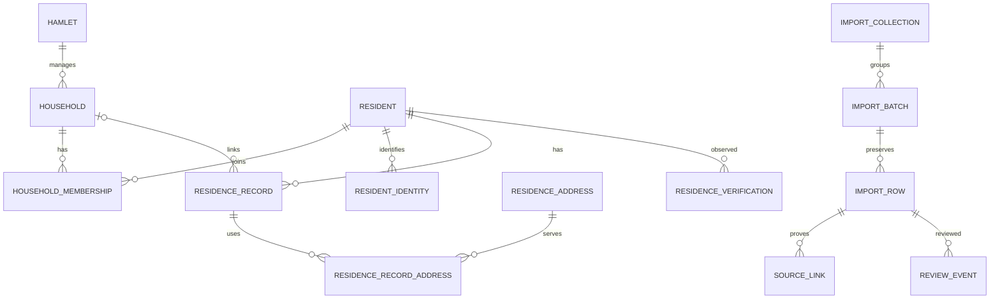

# Tái sử dụng household và resident cho dữ liệu Trung Chánh 2

> Cập nhật 27/10/2026: đã hợp nhất vào bảng lõi và bỏ mock khỏi dữ liệu nghiệp vụ. Xem [cấu trúc, hai menu, flow và recovery sau hợp nhất](luong-hop-nhat-ho-dan-nhan-khau.md). Các số liệu/mô tả cách ly bên dưới là mốc triển khai trước.

Ngày phân tích: 27/10/2026. Đây là đề xuất kiến trúc, chưa phải migration hay thay đổi database. Đối chiếu entity Java hiện hành, SQL `tc2_roster.sql`, mapping bốn workbook và kết quả nhập được ghi trong `tc2-roster-implementation.md`; chưa chạy lại thống kê database hoặc đọc lại toàn bộ workbook ở lần phân tích này.

## Kết luận

Có thể dùng `household` và `resident` hiện có làm hai bảng lõi duy nhất sau khi bổ sung cấu trúc. Không thể giữ nguyên hai bảng rồi nhập toàn bộ Excel mà vẫn đáp ứng đầy đủ nhiều hồ sơ cư trú, nguồn bất biến, đối soát và báo cáo lịch sử.

Schema `tc2_roster` hiện là vùng cách ly theo yêu cầu triển khai trước đó. Không nên duy trì hai bộ hộ/người cùng được chỉnh sửa vô thời hạn. Mục tiêu hợp nhất là một bộ dữ liệu chuẩn; nguồn gốc và lịch sử tiếp tục tồn tại độc lập.

## Đối chiếu cụ thể

| Nội dung nguồn/yêu cầu | Cấu trúc cũ | Điều chỉnh đề xuất |
| --- | --- | --- |
| Hộ, mã hộ, địa bàn, bản đồ | `household.code`, `hamlet_id`, tọa độ và các thuộc tính GIS | Tái sử dụng ID, FK và chức năng phù hợp; phân biệt hộ dân với cơ sở kinh doanh qua `type` |
| HSCT | Chưa có trường riêng | Thêm `source_case_number`, `case_scope`; mã hộ nội bộ khác HSCT; chỉ unique theo phạm vi đã xác minh |
| Địa chỉ nguồn | Có `house_number`, `street`, `alley`, `legacy_address` | Bổ sung địa chỉ nguyên văn; cho phép thiếu thành phần chưa tách được; không tự điền tên đường/số nhà |
| Chủ hộ/người đại diện | `owner_name` bắt buộc | Giữ tên đại diện nguồn riêng; xác lập chủ hộ qua membership, không suy ra chủ sở hữu nhà |
| Điện thoại | `owner_phone` bắt buộc | Cho phép NULL và sửa đồng bộ validation, DTO, UI; không tạo số giả |
| Nhân thân | `resident.full_name`, `birth_year`, `gender` | Tái sử dụng; thêm ngày sinh, độ chính xác DAY/YEAR/UNKNOWN, tên cha/mẹ |
| Định danh | Một `id_card_number` unique | Bảng `resident_identity` lưu nhiều giấy tờ/nguồn, trạng thái xác minh; trường cũ chỉ còn biểu diễn tương thích nếu cần |
| Quan hệ với hộ | `resident.household_id`, `relationship` | `household_membership` có vai trò và hiệu lực; FK cũ chỉ là thông tin hiện hành theo quy tắc rõ ràng, không làm nguồn lịch sử |
| Loại cư trú | Một `residence_type` và ngày đăng ký tạm trú | `residence_record` lưu nhiều đợt/loại; NOHT/Đ19 giữ nghĩa nguồn, không ép sang STAY/STAY_AWAY |
| Nhiều địa chỉ/người | Chưa đủ | Địa chỉ theo vai trò của từng hồ sơ: thường trú, hiện tại, tạm trú, trước chuyển đến |
| Trạng thái, phân loại, thời hạn | `notes` không đủ để thống kê có cấu trúc | Thuộc tính hồ sơ cư trú; giữ chuỗi gốc khi chưa hiểu rõ ý nghĩa |
| Dấu X thực tế cư trú | Chưa có | Ghi nhận xác minh riêng; ô trống là UNKNOWN, không phải ABSENT |
| Điểm ngẫu nhiên | Chỉ có latitude/longitude | Thêm phương pháp tọa độ, dấu vết sinh điểm; hiển thị vị trí tạm, không coi là nhà đã xác minh |
| Nhập Excel và lịch sử | Hai entity không có cơ chế tương đương module mới | Giữ staging, nguồn mã hóa bất biến, liên kết nguồn, quyết định review và lịch sử trước/sau |

`household` còn quản lý cơ sở kinh doanh. Các trường kinh doanh có thể tiếp tục nullable; chưa có căn cứ cần tách thêm bảng chỉ để giảm số cột. Các bộ đếm dân số là dữ liệu tính toán/cache, không lấy tuổi hoặc tổng nguồn làm số hiện hành cố định.

## Quan hệ mục tiêu

HOUSEHOLD và RESIDENT trong hình là hai bảng lõi hợp nhất. `source_link` liên kết nhiều dòng nguồn tới cùng thực thể; triển khai FK và kiểm tra loại đích phải được thiết kế khi chuyển kiểu ID. `change_event` ghi thay đổi các thực thể trong cùng giao dịch, chứa actor, lý do, trước/sau, thời điểm ghi nhận và ngày hiệu lực. Không vẽ quan hệ FK giả từ một cột entity ID tới nhiều bảng.

Một người có nhiều hồ sơ không có nghĩa được đếm nhiều lần. Membership phải phân biệt hiệu lực và loại quan hệ trước khi đưa ra quy tắc một hộ hiện hành. Không tự suy ra ngày bắt đầu từ ngày nhập Excel.

## Tối ưu số bảng ở đâu?

Ưu tiên bỏ sự trùng lặp của hai bộ bảng lõi sau chuyển đổi, thay vì bỏ bảng có ý nghĩa khác nhau:

- Dùng lại `public.household`, `public.resident` với ID bigint; các bảng phụ trong schema riêng có thể tham chiếu hai bảng này.
- Giữ collection/batch/row vì lần lượt biểu diễn bộ nhập, file và dòng nguồn. Gộp chúng làm lặp metadata hoặc mất khả năng chống nhập lại/đối soát.
- Giữ membership, residence_record, identity và verification vì chúng có số lượng và vòng đời khác nhân thân.
- Có thể thay cặp `residence_address` + `residence_record_address` bằng một bảng con địa chỉ theo vai trò, nếu không cần chia sẻ địa chỉ. Chỉ thực hiện khi sửa importer, API và lịch sử tương ứng; đây không phải điều kiện để tái sử dụng bảng lõi.
- Giữ audit nghiệp vụ và review nguồn riêng ở giai đoạn chuyển đổi. Không gộp chỉ để giảm số bảng khi chưa chứng minh giảm độ phức tạp.

Nguồn đánh dấu bằng `origin` và liên kết source, nhưng một bản ghi có thể vừa bắt nguồn Excel vừa được sửa thủ công. Không đổi origin thành MANUAL để làm mất xuất xứ; mỗi thao tác sau import được thể hiện bằng event riêng.

## Lộ trình hợp nhất có recovery

1. Backup và restore thử database hiện tại, nguồn mã hóa và khóa. Đóng băng một mốc đối chiếu; thử nghiệm trên database restore trước.
2. Migration cộng thêm cho hai bảng cũ: trường mới, nullable cần thiết, version và cơ chế audit. Cập nhật tất cả đường ghi cũ để không có chỉnh sửa bỏ qua lịch sử; kiểm tra lại quyền địa bàn và GIS.
3. Lập bảng ánh xạ UUID trong `tc2_roster` sang bigint của bảng lõi. Mỗi đối tượng nguồn có một đích; việc nhiều nguồn chung đích phải có quyết định rõ ràng. Không cast UUID thành bigint.
4. Đối chiếu dữ liệu cũ với dữ liệu thật. Không ghép theo tên/địa chỉ đơn lẻ; không mặc định dữ liệu cũ là dữ liệu chuẩn hoặc dữ liệu giả. Giữ các trường đã xác minh và đưa bất đồng vào review.
5. Chuyển bản ghi đã duyệt và FK phụ qua ánh xạ. Giữ ID sự kiện lịch sử gốc, phạm vi schema/thực thể gốc và bảng ánh xạ để truy vết; không sửa đè lịch sử bất biến. Audit đích cần phân biệt MIGRATION với biến động dân cư thực tế để báo cáo không đếm việc chuyển schema thành tăng dân số.
6. Kiểm tra các mốc nhập đã ghi nhận: 5.213 dòng nghiệp vụ, 5.151 đã áp dụng, 62 chờ review; 5.073 cá nhân, 5.150 hồ sơ; 752 khóa HSCT và 538 nhóm tạm. Đây là số tại lần nhập ban đầu, cần chụp lại số hiện hành trước chuyển đổi nếu đã có chỉnh sửa. Không báo cáo 1.290 nhóm là 1.290 hộ đã xác minh.
7. Đối chiếu nguồn, giấy tờ, ngày sinh precision, địa chỉ ngoài TC2, membership, RBAC, API cũ, bản đồ, thống kê và lịch sử; kiểm tra sửa đồng thời và nhập lại không sinh trùng.
8. Cutover với cửa sổ dừng ghi ngắn, áp dụng delta rồi chuyển toàn bộ đường ghi sang lõi chung. Giữ bản cũ chỉ đọc trong thời gian đối soát, tránh hai nơi cùng chỉnh sửa.
9. Recovery sau cutover phải xử lý cả những thay đổi mới: dừng ghi, xuất/replay delta hoặc phục hồi bản backup tương ứng. Chỉ đổi cấu hình về schema cũ sẽ làm mất các thao tác phát sinh sau cutover. Chưa xóa bảng cũ cho tới khi nghiệm thu và hết thời gian lưu phục hồi.

Đề xuất này không tự ý hợp nhất dữ liệu đang chạy. Lợi ích chính là tận dụng API/GIS và định danh hộ/người hiện có; chi phí chính là chuyển FK, bảo toàn lịch sử và sửa toàn bộ đường ghi để cùng một quy tắc nghiệp vụ.
