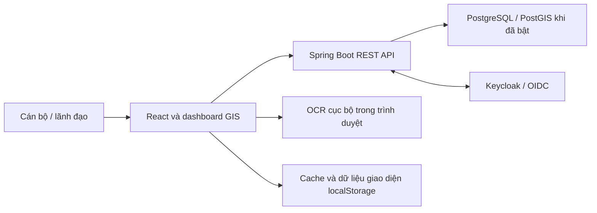

# Tổng quan dự án, mục tiêu và quy chuẩn phát triển

Ngày khảo sát: 09/10/2026. Phạm vi: mã nguồn và tài liệu trong checkout `police-jhip`, bao gồm các thay đổi chưa commit đang có. Đây là tài liệu định hướng để chủ dự án lựa chọn goal và rule; các đề xuất chưa phải quyết định đã được phê duyệt.

## 1. Định hướng cao nhất

**Chuyển đổi số công việc quản lý địa bàn cho cán bộ khu vực, xã/phường và thành phố: dữ liệu được cập nhật tại nơi phát sinh, công việc có người chịu trách nhiệm, hồ sơ có thể tra cứu và tổng hợp, mọi truy cập và thay đổi quan trọng có thể kiểm tra.**

Giá trị cần đạt là giảm nhập liệu lặp lại, giảm thời gian tìm hồ sơ và lập báo cáo, tăng chất lượng dữ liệu và khả năng phối hợp. Bản đồ, OCR và 3D là công cụ hỗ trợ các kết quả này. Số màn hình hoặc độ đẹp của bản đồ không đủ để đánh giá chuyển đổi số.

Đề xuất tầm nhìn sản phẩm: một nền tảng quản lý địa bàn dùng chung, triển khai thử ở một đơn vị, sau đó mở rộng theo phạm vi dữ liệu và thẩm quyền của từng cấp. Dự án hiện tập trung nhiều vào nghiệp vụ quản lý dân cư và an ninh địa bàn; chưa thể coi là nền tảng bao phủ toàn bộ nghiệp vụ của chính quyền xã/phường hoặc thành phố.

## 2. Người dùng và kết quả mong đợi

| Nhóm người dùng đề xuất | Công việc chính                                                        | Kết quả cần có                                                             |
| ----------------------- | ---------------------------------------------------------------------- | -------------------------------------------------------------------------- |
| Cán bộ khu vực          | Tra cứu hộ/cơ sở, cập nhật cư dân, ghi nhận kiểm tra và việc cần xử lý | Một hồ sơ thống nhất, thao tác được trên thiết bị thực địa, ít nhập lại    |
| Lãnh đạo xã/phường      | Phân công, kiểm tra chất lượng, theo dõi tiến độ, tổng hợp báo cáo     | Biết ai phụ trách, việc nào quá hạn, dữ liệu nào chưa xác minh             |
| Cấp thành phố           | Tổng hợp giữa các đơn vị, theo dõi chỉ tiêu, điều phối theo thẩm quyền | Chỉ tiêu thống nhất, có nguồn và thời điểm, truy cập chi tiết có kiểm soát |
| Quản trị hệ thống       | Quản lý tài khoản, cấu hình, vận hành và phục hồi                      | Hệ thống ổn định, cấp quyền đúng, kiểm tra được sự cố                      |

Không đồng nhất quyền quản trị kỹ thuật với quyền xem toàn bộ hồ sơ nghiệp vụ. Phạm vi thành phố là mục tiêu mở rộng; mô hình phân cấp và cách tổng hợp liên đơn vị chưa được backend hiện tại thực thi đầy đủ.

## 3. Hiện trạng dự án

### 3.1. Kiến trúc và công nghệ trong repository

| Thành phần    | Hiện trạng quan sát được                                                          |
| ------------- | --------------------------------------------------------------------------------- |
| Kiểu ứng dụng | JHipster monolith, tên kỹ thuật `Monolithic`, phiên bản ứng dụng `0.0.1-SNAPSHOT` |
| Backend       | Java 21, Spring Boot parent 4.1.1, Maven; JPA, service, DTO/MapStruct, REST       |
| Frontend      | React 19, TypeScript, Vite, Redux Toolkit; dashboard GIS tùy biến                 |
| Database      | PostgreSQL, Liquibase; có migration nền tảng PostGIS                              |
| Đăng nhập     | OAuth2/OIDC, cấu hình Keycloak; dashboard đọc phiên backend                       |
| Bản đồ        | Leaflet, MapLibre GL, Three.js; nhiều cách xem bản đồ và sơ đồ                    |
| OCR           | Tesseract.js, mô hình tiếng Việt/Anh đóng gói cục bộ trong trình duyệt            |
| Kiểm thử      | Vitest, các test Java và REST integration; script CRUD/persistence riêng          |
| Vận hành      | Docker Compose, Actuator, cấu hình Sonar và script build/test                     |

Các phiên bản trên lấy từ cấu hình checkout, không phải khuyến nghị phiên bản mới nhất. JDL có chú thích Spring Boot 3, nhưng `pom.xml` khai báo 4.1.1; khi xác định cấu hình build phải ưu tiên file đang được build và đồng bộ lại tài liệu cũ. Java target là 21 trong khi image JRE của Jib là 25; nên chốt và kiểm tra ma trận runtime trước phát hành.

Luồng chính:



Sơ đồ mô tả kiến trúc hiện có; không hàm ý dữ liệu localStorage được đồng bộ đầy đủ với server.

### 3.2. Năng lực đã có và giới hạn

| Mảng                  | Có trong mã nguồn                                                      | Giới hạn cần biết                                                                                                |
| --------------------- | ---------------------------------------------------------------------- | ---------------------------------------------------------------------------------------------------------------- |
| Hộ dân/cơ sở          | CRUD, địa chỉ, chủ hộ, loại cơ sở, trạng thái, tọa độ, liên kết cư dân | Cần thống nhất nguồn số liệu dân số, kiểm tra trùng và quy trình xác minh                                        |
| Nhân khẩu             | CRUD, giấy tờ, năm sinh, giới tính, loại cư trú, liên kết hộ           | Chưa đủ để kết luận đã xử lý toàn bộ vòng đời biến động cư trú                                                   |
| Địa bàn               | `AreaZone`, liên kết hộ, ranh GeoJSON                                  | Chưa có mô hình đầy đủ cho đơn vị hành chính và phân công có hiệu lực theo thời gian                             |
| Hồ sơ                 | `DocumentRecord`, trạng thái, hạn, cán bộ, ghi chú                     | Chưa thể coi là hệ thống lưu trữ tệp, ký số và phê duyệt hồ sơ hoàn chỉnh                                        |
| Cảnh báo              | `SecurityAlert` và giao diện theo dõi                                  | Có cả dữ liệu API và cấu hình/cảnh báo cục bộ; cần làm rõ từng nguồn                                             |
| Nhật ký               | `PatrolLog`, API ghi/đọc, giao diện nhật ký                            | Chưa phải audit bảo đảm do server tạo, bất biến và đủ mọi thao tác                                               |
| Đăng nhập/quyền       | Phiên OIDC, CSRF, role GIS ánh xạ từ authority                         | Đăng nhập chưa đồng nghĩa với giới hạn dữ liệu theo địa bàn                                                      |
| OCR/camera            | Nhận dạng ảnh, người dùng xác nhận trước lưu                           | Không xác minh danh tính; ảnh kiểm tra có phần lưu trong trình duyệt                                             |
| GIS 2D/3D             | Hộ có tọa độ, ranh khu vực, lớp nhà/đường, tìm kiếm, heatmap           | Footprint mặc định là minh họa; GeoJSON nhập ở màn review chưa lưu vào các bảng GIS                              |
| Không gian 3D Bà Điểm | Tab và dữ liệu không gian trong thay đổi chưa commit                   | Có dữ liệu sinh/dựng từ module riêng; phải kiểm định nguồn, độ chính xác và liên kết hồ sơ trước sử dụng thực tế |
| PostGIS               | Migration extension, điểm hộ, geometry nhà/đường, chỉ mục GiST         | Có thể bỏ qua migration nếu DB thiếu extension; chưa xác minh DB đang chạy                                       |
| Quản trị/phân công    | Menu, danh sách tài khoản, địa bàn và phân quyền giao diện             | Một phần là seed/localStorage; không phải nguồn quyền có hiệu lực tại API                                        |

Đánh giá từ khảo sát mã nguồn: nền tảng nghiệp vụ và giao diện đã hình thành, nhưng chưa đủ bằng chứng để xác nhận sẵn sàng vận hành với dữ liệu thật hoặc triển khai toàn thành phố. Chưa chạy ứng dụng, kiểm thử, truy vấn DB hoặc đánh giá tải trong lần lập tài liệu này.

### 3.3. Mô hình dữ liệu đang có

Sáu thực thể nghiệp vụ chính: `Household`, `Resident`, `AreaZone`, `DocumentRecord`, `SecurityAlert`, `PatrolLog`. Quan hệ đã thể hiện rõ: một địa bàn có nhiều hộ, một hộ có nhiều cư dân. Một số trường hồ sơ/cảnh báo vẫn chứa tên, địa chỉ hoặc vị trí dạng chuỗi; cần xác định liên kết bằng ID khi thiết kế quy trình tiếp theo.

Migration GIS bổ sung `gis_map`, `gis_building_type`, `gis_road`, `gis_building`, `gis_map_layer`, `gis_map_source`. Nhà GIS liên kết nullable với hộ, địa bàn, đường và loại nhà. Không tạo bản sao hồ sơ cư dân trong bảng hình học.

Các nhóm dữ liệu **đề xuất bổ sung sau khi chốt nghiệp vụ**:

- Đơn vị quản lý có mã ổn định, quan hệ cấp trên và thời gian hiệu lực.
- Phân công cán bộ theo đơn vị/địa bàn, thời gian hiệu lực và phạm vi thao tác.
- Công việc/đợt kiểm tra: người phụ trách, hạn, trạng thái, kết quả và hồ sơ liên quan.
- Tệp đính kèm: nơi lưu, chủ sở hữu, quyền đọc, thời hạn lưu và lịch sử truy cập.
- Audit nghiệp vụ do server sinh; định nghĩa chỉ tiêu và kỳ báo cáo.

### 3.4. Những khoảng trống nên xử lý trước

1. **Phân quyền dữ liệu:** `SecurityConfiguration` yêu cầu xác thực với `/api/**`, nhưng chưa có cơ chế đầy đủ giới hạn hộ/cư dân theo địa bàn được phân công. API trực tiếp phải chịu cùng chính sách với giao diện.
2. **Nguồn dữ liệu:** `firestoreService.ts` thực tế phối hợp API PostgreSQL, localStorage và EventTarget. Tên file không chứng minh đang dùng Firestore hoặc đồng bộ thời gian thực giữa thiết bị. `authService.ts` còn seed tài khoản/menu/phân công cục bộ.
3. **Bảo vệ dữ liệu nhạy cảm:** `cryptoUtils.ts` chứa khóa AES cố định phía frontend và fallback Base64. Không thể dùng cơ chế này làm bảo đảm bảo mật CCCD khi vận hành thật; cần quản lý khóa bên server và phương án chuyển dữ liệu cũ.
4. **Khả năng tổng hợp:** hàm tải hộ/cư dân lấy trang đầu với giới hạn 1.000 hộ và 3.000 cư dân; nhật ký/cảnh báo cũng có giới hạn riêng. Báo cáo từ dữ liệu đã tải có thể thiếu bản ghi khi mở rộng.
5. **Tính nhất quán khi ghi:** một số wrapper bắt lỗi và chỉ ghi console. Cần kiểm tra toàn bộ đường lưu để tránh báo thành công khi server chưa ghi; thao tác hộ và cư dân cần quy định tính nguyên tử.
6. **Audit:** nhật ký công tác đang được dùng cho cả lịch sử thao tác, có dữ liệu khởi tạo và metadata từ client. Cần tách trách nhiệm ghi công tác với audit truy cập/thay đổi do server kiểm soát.
7. **GIS thực địa:** cần phân biệt tọa độ khảo sát, ước lượng, sơ đồ và geometry thật; bảng mới hoặc màn 3D không chứng minh đã có dữ liệu chuẩn.
8. **Bảo trì:** có component cùng tên ở `gis/` và `gis/components/`; `App.tsx` hiện chủ yếu import từ `components/`. Kiểm tra nơi sử dụng trước sửa hoặc xóa, tránh sửa nhầm bản không được dùng.

## 4. Goal đề xuất

### 4.1. Goal sản phẩm

> Trong một đợt thử nghiệm tại một xã/phường được lựa chọn, hoàn thành chu trình tra cứu → cập nhật hồ sơ → ghi nhận kiểm tra → giao/theo dõi xử lý → tổng hợp báo cáo trên một nguồn dữ liệu chung, có quyền theo địa bàn và lịch sử do server ghi nhận; đo được mức giảm thời gian thao tác so với quy trình hiện tại.

Thời lượng, đơn vị và số người thử nghiệm phải được chốt khi có nguồn lực. Không coi định hướng này là cam kết tiến độ.

### 4.2. Bộ chỉ số nghiệm thu ban đầu

Các ngưỡng dưới đây là **đề xuất**, cần đo baseline và xác nhận với đơn vị thử nghiệm.

| Mục tiêu                  | Cách đo                                                        | Ngưỡng khởi điểm đề xuất                                        |
| ------------------------- | -------------------------------------------------------------- | --------------------------------------------------------------- |
| Giảm thời gian tra cứu    | So sánh cùng nhóm tác vụ trước/sau                             | Giảm ít nhất 30% thời gian trung vị                             |
| Giảm lập báo cáo thủ công | Đo thời gian chuẩn bị cùng một báo cáo                         | Giảm ít nhất 50%                                                |
| Dữ liệu đủ dùng           | Hồ sơ đủ trường bắt buộc / tổng hồ sơ trong phạm vi thử nghiệm | Từ 95%; công bố số hồ sơ chưa xác minh                          |
| Kiểm soát phạm vi         | Test chéo đơn vị/địa bàn cho đọc, ghi, xuất và tổng hợp        | 100% trường hợp trái quyền bị từ chối                           |
| Ghi nhận thay đổi         | Đối chiếu thao tác quan trọng với audit server                 | 100% thao tác trong danh mục đã thống nhất                      |
| Ghi dữ liệu đúng          | Lưu, tải lại, mở ở thiết bị thứ hai; kiểm tra lỗi mạng         | Không mất dữ liệu đã báo lưu thành công                         |
| Tra cứu đáp ứng           | Đo p95 với tập dữ liệu và số người đồng thời được chốt         | API tra cứu dưới 2 giây trong môi trường thử nghiệm             |
| Khả năng phục hồi         | Khôi phục backup vào môi trường độc lập                        | Khôi phục và đối chiếu dữ liệu thành công trước thử nghiệm thật |

Không đo hiệu quả bằng số hồ sơ tạo ra đơn thuần. Báo cáo phải có phạm vi, kỳ, thời điểm cập nhật, định nghĩa chỉ tiêu và mức đầy đủ của dữ liệu.

### 4.3. Thứ tự ưu tiên

| Giai đoạn                  | Công việc chính                                                                  | Điều kiện hoàn tất                                                  |
| -------------------------- | -------------------------------------------------------------------------------- | ------------------------------------------------------------------- |
| G0 — Chốt nghiệp vụ        | Chọn đơn vị thử nghiệm, người dùng, 3–5 luồng chính, dữ liệu và baseline         | Có phạm vi, chủ sở hữu, tiêu chí nghiệm thu và danh mục quyền       |
| G1 — Nền tảng tin cậy      | Backend phân quyền địa bàn, thống nhất nguồn dữ liệu, bảo vệ CCCD, audit, backup | Test API trái quyền/lưu lỗi đạt; phục hồi dữ liệu thành công        |
| G2 — Công việc hằng ngày   | Hồ sơ hộ/cư dân, kiểm tra, công việc, hạn xử lý, tệp, báo cáo xã/phường          | Người dùng hoàn thành các luồng đã chọn trên dữ liệu thử            |
| G3 — GIS phục vụ công việc | Kiểm định tọa độ, truy vấn theo viewport, liên kết nhà/đường với hồ sơ           | Phân biệt dữ liệu thật/minh họa; kiểm tra địa lý và hiệu năng đạt   |
| G4 — Mở rộng thành phố     | Phân cấp nhiều đơn vị, chỉ tiêu chung, quyền xem chi tiết, tải và vận hành       | Thử nghiệm liên đơn vị, tổng hợp không thiếu/trùng, đạt tải đã chốt |

Khuyến nghị goal tiếp theo là **G0 rồi G1**. Chỉ ưu tiên thêm 3D nếu một tác vụ cụ thể của cán bộ cần nó và có dữ liệu phù hợp.

Ngoài phạm vi MVP đề xuất: AI dự báo rủi ro, nhận diện khuôn mặt, ứng dụng native, microservices, mô hình 3D toàn thành phố và tích hợp hệ thống bên ngoài chưa có quyền truy cập được xác nhận.

## 5. Quy chuẩn đề xuất khi tiếp tục phát triển

### 5.1. Nghiệp vụ và trải nghiệm

- Mỗi tính năng phải gắn với người dùng, tác vụ, kết quả và tiêu chí nghiệm thu. Ưu tiên thao tác tra cứu/cập nhật/kiểm tra tại thực địa.
- Trạng thái công việc phải có chuyển trạng thái rõ, người chịu trách nhiệm, thời điểm và điều kiện hoàn tất. Phân biệt cảnh báo hồ sơ với kết luận nghiệp vụ.
- Dữ liệu OCR là bản nháp; người dùng kiểm tra trước ghi. Không tự điền thông tin không đọc được hoặc coi OCR là xác minh danh tính.
- Hiển thị đang tải, dữ liệu trống, mất kết nối và lưu thất bại riêng biệt. Chỉ báo lưu thành công sau xác nhận từ API.
- Dữ liệu minh họa/seed phải được nhận biết rõ và không đi vào báo cáo nghiệp vụ thật.

### 5.2. Dữ liệu

- PostgreSQL qua API là nguồn chính thức cho hồ sơ dùng chung. localStorage chỉ dành cho tùy chọn giao diện/cache được quy định; không cấp quyền hoặc giữ bản duy nhất của hồ sơ.
- Mỗi hồ sơ có ID ổn định; liên kết bằng khóa ngoại, không dựa vào tên cán bộ, tên hộ hay chuỗi địa chỉ. Mã hiển thị và ID kỹ thuật có vai trò riêng.
- Định nghĩa rõ nguồn số cư dân: danh sách cư dân, số khai báo và số đã xác minh không được âm thầm thay thế nhau.
- Ngày nghiệp vụ dùng kiểu ngày; thời điểm sự kiện lưu theo UTC và hiển thị theo múi giờ đơn vị. Chuẩn hóa các trường ngày đang là chuỗi khi cần xử lý hạn/báo cáo.
- Chốt quy tắc chuyển hộ, đổi địa bàn, trùng giấy tờ, xóa/archived và lịch sử. Không mặc định một bản ghi cư dân hiện tại đủ biểu diễn mọi biến động cư trú.
- Mọi thay đổi schema qua Liquibase; có kế hoạch chuyển dữ liệu và phục hồi. Không sửa migration đã áp dụng ở môi trường dùng chung.
- Thao tác nhiều thực thể phải xác định giao dịch và xử lý lỗi; ngăn mất cập nhật khi hai cán bộ sửa đồng thời.

### 5.3. Quyền và bảo vệ dữ liệu

- Server quyết định quyền theo **vai trò + phạm vi đơn vị/địa bàn + hành động**. Kiểm tra với danh sách, chi tiết, tìm kiếm, xuất tệp, thống kê và endpoint bản đồ.
- Không tin role, cán bộ thực hiện, IP hay phạm vi gửi từ client. Lấy danh tính thực hiện từ phiên/token được xác minh; ghi audit tại server.
- Che số giấy tờ theo mặc định, chỉ trả trường cần thiết; kiểm soát xem đầy đủ và xuất hàng loạt theo tác vụ.
- Không đặt khóa mã hóa hoặc bí mật vận hành trong frontend/repository. Mã hóa cần có quản lý khóa, phiên bản khóa, phục hồi và kế hoạch chuyển dữ liệu; lỗi mã hóa không được âm thầm đổi sang Base64.
- Không ghi CCCD, ảnh giấy tờ, token hoặc hồ sơ đầy đủ vào console/log. Xác định thời hạn lưu ảnh, tệp và audit trước triển khai thật.
- Audit ghi tối thiểu người thực hiện, hành động, thực thể, thời điểm, kết quả và mã truy vết; bảo vệ khỏi sửa/xóa bởi người dùng nghiệp vụ. Theo dõi cả đọc/xuất nhạy cảm theo chính sách đã chốt.

### 5.4. GIS

- GeoJSON dùng WGS84/EPSG:4326 theo thứ tự `[longitude, latitude]`; chuyển đổi tường minh với tuple giao diện `[latitude, longitude]`.
- Không suy ra GPS từ tên đường hoặc DXF chưa có điểm khống chế. Dữ liệu sơ đồ có hệ tọa độ riêng phải được đánh dấu.
- Footprint/chiều cao mặc định chỉ là minh họa. Lưu nguồn, mức xác minh, thời điểm và độ chính xác khi thu thập dữ liệu địa lý.
- Nhà GIS liên kết với hồ sơ bằng `householdId`; không tạo bản sao hộ/cư dân cho mỗi kiểu bản đồ.
- Kiểm tra geometry, loại hình học, phạm vi tọa độ, kích thước file và dữ liệu thuộc tính khi nhập. Nhập để xem và nhập ghi DB là hai thao tác có trạng thái rõ.
- Khi mở rộng, dùng viewport/phân trang/tổng hợp server; không tải toàn bộ hồ sơ dân cư để dựng một màn bản đồ. Nhãn cá nhân chỉ hiển thị theo quyền và lựa chọn cần thiết.

### 5.5. Kiến trúc, chất lượng và cách làm với AI

- Giữ monolith có ranh giới module rõ ở giai đoạn đầu. Chỉ tách dịch vụ khi có nhu cầu vận hành được chứng minh.
- Chọn một đường component được sử dụng chính thức; giảm trùng sau khi kiểm tra imports. Không sinh lại JHipster/JDL mà chưa xem diff tác động tới mã tùy biến.
- Không gọi dữ liệu localStorage là realtime đa thiết bị; không coi migration tồn tại là DB đã nâng cấp.
- Mỗi thay đổi trình bày vấn đề, hành vi sau sửa, ảnh hưởng dữ liệu/quyền và cách kiểm tra. Không đưa thư viện mới nếu công cụ hiện có đáp ứng được.
- Test phải bao phủ rủi ro: vượt phạm vi, lưu thất bại, giao dịch, thiếu trang dữ liệu, đối chiếu thống kê và geometry; không chỉ kiểm tra render thành công.
- AI phải đọc luồng liên quan trước sửa, giữ thay đổi đang có của người dùng, phân biệt phát hiện với giả định, và không tuyên bố test pass khi chưa chạy.
- Tách commit/tác vụ theo mục tiêu; cập nhật tài liệu khi thay đổi nguồn dữ liệu, quyền, API hoặc cách vận hành.

### 5.6. Vận hành

- Tách dev/test/production; seed chỉ dùng đúng môi trường. Bí mật lấy từ cấu hình an toàn của môi trường.
- Chốt backup, thời gian mất dữ liệu tối đa chấp nhận được (RPO), thời gian phục hồi (RTO), người xử lý sự cố và lịch diễn tập.
- Không dùng lệnh xóa Docker volume để sửa lỗi trên môi trường có dữ liệu cần giữ. Nâng PostgreSQL/PostGIS phải có backup đã thử phục hồi.
- Kiểm tra các endpoint management công khai trong cấu hình hiện tại và giới hạn ở tầng triển khai theo nhu cầu vận hành.
- Phát hành phải có kiểm tra sức khỏe, theo dõi lỗi, hướng dẫn rollback và đối chiếu dữ liệu sau migration.

## 6. Definition of Done đề xuất

Một tính năng chỉ hoàn tất khi:

1. Người dùng thực hiện được luồng và các tiêu chí nghiệm thu đã chốt.
2. API thực thi quyền theo phạm vi, kể cả khi gọi trực tiếp ngoài giao diện.
3. Dữ liệu đã lưu còn đúng sau tải lại và mở ở tài khoản/thiết bị được phép khác.
4. Lỗi mạng, validation và xung đột không gây báo thành công sai hoặc dữ liệu dở dang.
5. Audit và migration được xử lý nếu thay đổi có liên quan.
6. Các test/check phù hợp đã chạy, có kết quả và giới hạn kiểm chứng rõ.
7. Tài liệu sử dụng/vận hành được cập nhật nếu hành vi thay đổi.

Với thay đổi code, các lệnh tham chiếu từ repository gồm `npm run lint`, `npm test`, `npm run webapp:build:dev` và `.\mvnw.cmd verify`. Chọn tập kiểm tra theo phạm vi; test backend có thể cần Docker/DB/OIDC tùy cấu hình. Không cần chạy toàn bộ test ứng dụng cho một thay đổi tài liệu thuần túy.

## 7. Mẫu đặt goal cho từng đợt làm

```text
Tên goal:
Người dùng và đơn vị thử nghiệm:
Vấn đề hiện tại / baseline:
Kết quả nghiệp vụ cần đạt:
Phạm vi làm:
Ngoài phạm vi:
Nguồn dữ liệu và chủ sở hữu:
Vai trò / phạm vi / hành động được phép:
Luồng chính và luồng lỗi:
Tiêu chí nghiệm thu đo được:
Yêu cầu migration, bảo vệ dữ liệu và vận hành:
Các test/check bắt buộc:
Người nghiệm thu:
Điều kiện triển khai và phục hồi:
```

Ví dụ goal đầu tiên: “Phân công địa bàn và kiểm soát truy cập hộ/cư dân tại backend”. Kết quả: cán bộ chỉ đọc/ghi trong phạm vi còn hiệu lực; lãnh đạo đọc theo đơn vị; quản trị kỹ thuật không tự động có toàn quyền nghiệp vụ. Nghiệm thu bằng test chéo địa bàn cho danh sách, ID trực tiếp, cập nhật, xóa, thống kê và dữ liệu bản đồ. Mô hình phân công, khả năng một cán bộ phụ trách nhiều địa bàn và trường hợp bàn giao phải được chốt trước thiết kế schema.

## 8. Các quyết định chủ dự án cần chốt

| Quyết định                                 | Đề xuất khởi điểm                                                            |
| ------------------------------------------ | ---------------------------------------------------------------------------- |
| Sản phẩm phục vụ ai trước?                 | Cán bộ khu vực và lãnh đạo một xã/phường                                     |
| 3–5 tác vụ quan trọng nhất?                | Tra cứu hộ/cư dân, cập nhật biến động, ghi kiểm tra, theo dõi xử lý, báo cáo |
| Dữ liệu nào đủ điều kiện đưa vào hệ thống? | Có nguồn, người chịu trách nhiệm, phạm vi sử dụng và quy trình đối chiếu     |
| Quyền thành phố tới đâu?                   | Tổng hợp mặc định; truy cập hồ sơ chi tiết theo thẩm quyền được xác nhận     |
| Bản đồ dùng cho tác vụ nào?                | Tìm hồ sơ theo vị trí, xác định địa bàn, hỗ trợ kiểm tra                     |
| Có bắt buộc offline không?                 | Chốt theo khảo sát kết nối; offline cần thiết kế hàng đợi và xung đột riêng  |
| Hồ sơ/ảnh lưu ở đâu, bao lâu?              | Kho lưu trữ có kiểm soát và chính sách lưu đã thống nhất                     |
| Ai nghiệm thu và vận hành?                 | Chỉ định chủ nghiệp vụ, chủ dữ liệu và người vận hành                        |

Tên đơn vị, ranh giới và mã hành chính trong seed/tài liệu là dữ liệu tham khảo của checkout, không phải xác nhận cơ cấu hiện hành. Cần kiểm chứng bằng nguồn được đơn vị sử dụng chấp thuận. Tài liệu này không thực hiện rà soát pháp lý hoặc kết luận đáp ứng quy định; yêu cầu áp dụng phải được xác nhận trước vận hành dữ liệu thật.

## 9. Bản đồ mã nguồn và căn cứ khảo sát

| Đường dẫn                                                                  | Vai trò                                                         |
| -------------------------------------------------------------------------- | --------------------------------------------------------------- |
| `README.md`, `package.json`, `pom.xml`, `.yo-rc.json`                      | Cấu hình, stack, lệnh build/test và nền tảng sinh mã            |
| `jhipster-ward-management.jdl`, `.jhipster/`                               | Khai báo mô hình ban đầu; đối chiếu với code/migration hiện tại |
| `src/main/java/com/policemanagement/com/domain/`                           | Thực thể dữ liệu thực tế                                        |
| `src/main/java/com/policemanagement/com/web/rest/`                         | Endpoint nghiệp vụ và quản trị                                  |
| `src/main/java/com/policemanagement/com/service/`                          | Service, DTO, mapper và criteria/query                          |
| `src/main/java/com/policemanagement/com/config/SecurityConfiguration.java` | Chính sách xác thực, CSRF và endpoint                           |
| `src/main/resources/config/liquibase/`                                     | Schema/migration được ứng dụng nạp                              |
| `src/main/webapp/app/routes.tsx`, `gis/App.tsx`                            | Route dashboard và luồng điều phối GIS                          |
| `src/main/webapp/app/gis/components/`                                      | Các màn nghiệp vụ/bản đồ đang được App import                   |
| `src/main/webapp/app/gis/services/`                                        | Phiên backend, API, OCR và lớp dịch vụ cục bộ                   |
| `src/main/webapp/app/gis/utils/cryptoUtils.ts`                             | Cơ chế mã hóa phía client cần thay trước vận hành thật          |
| `src/main/webapp/app/gis/data/`, `models/`                                 | Seed, sơ đồ và dữ liệu/kiểu không gian                          |
| `src/main/webapp/app/entities/`                                            | Giao diện CRUD JHipster song song dashboard                     |
| `src/test/`, các file `*.spec.*`, `scripts/`                               | Test và công cụ dữ liệu; script không chứng minh đã chạy đạt    |
| `src/main/docker/`                                                         | Cấu hình DB, OIDC và triển khai                                 |

Tài liệu đối chiếu: [GIS, đăng nhập và OCR](gis-auth-ocr.md), [MapLibre địa lý 2D/3D](maplibre-geographic-3d.md), [sơ đồ ấp TC2](maplibre-ap-tc2.md), [lộ trình PostGIS](postgis-migration.md), [thiết kế database 3D](spatial_3d_database_schema.md). Nội dung thiết kế phải đối chiếu migration và API trước khi coi là chức năng đã triển khai.

Tài liệu này là một file tổng hợp để đặt mục tiêu và quy chuẩn; chưa tạo goal tự động, chưa áp quy tắc vào `AGENTS.md` và chưa thay đổi chức năng ứng dụng.
