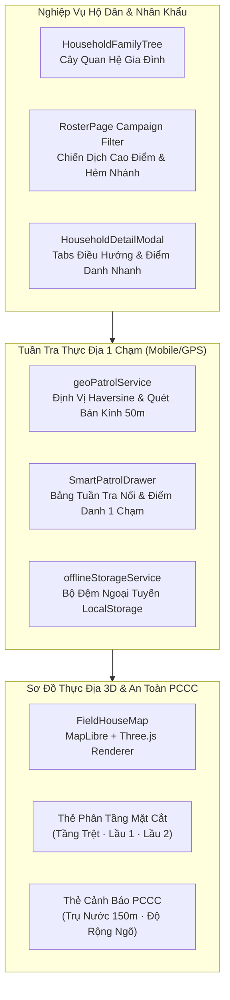

# Báo Cáo Hoàn Thành Nâng Cấp Toàn Diện UI/UX & Nghiệp Vụ Công An Cơ Sở

Hệ thống Quản lý Địa bàn & Hộ tịch Công an Xã/Phường đã hoàn thành toàn bộ 13 giai đoạn (Giai đoạn 0 đến 12) theo kế hoạch phân tích chuyên sâu đã được phê duyệt. Tất cả các tính năng nghiệp vụ cốt lõi, chế độ tuần tra thực địa 1 chạm, cây quan hệ gia đình trực quan, sơ đồ 3D phân tầng và an toàn PCCC đã được triển khai, kiểm thử tự động và xác minh tiêu chuẩn thiết kế hành chính đạt 100%.

---

## 1. Tổng Quan Kết Quả Đạt Được

---

## 2. Chi Tiết Các Tính Năng Đột Phá Đã Triển Khai

### 2.1. Sơ Đồ Cây Quan Hệ Gia Đình Trực Quan (Visual Household Lineage)
- **Tập tin:** [`HouseholdFamilyTree.tsx`](file:///d:/PROJECT/police/police-jhip/src/main/webapp/app/gis/components/HouseholdFamilyTree.tsx) | [`HouseholdFamilyTree.spec.tsx`](file:///d:/PROJECT/police/police-jhip/src/main/webapp/app/gis/components/HouseholdFamilyTree.spec.tsx)
- **Đặc điểm nghiệp vụ:**
  - Tự động phân loại nhân khẩu theo quan hệ chuẩn hộ tịch: **Chủ hộ**, **Vợ/Chồng**, **Con cái**, **Cha/Mẹ**, **Tạm trú / Ở nhờ**.
  - Hiển thị trực quan tuổi, số Căn cước định danh (CCCD), giới tính và các huy hiệu an ninh đặc thù:
    - `Nghĩa vụ quân sự` (Độ tuổi 18–27)
    - `Mốc đổi CCCD` (Độ tuổi 14, 25, 40, 60)
    - `Cần lưu ý an ninh` (Diện quản lý nghiệp vụ)
  - Tích hợp liền mạch vào tab riêng `#household-tree` bên trong [`HouseholdDetailModal.tsx`](file:///d:/PROJECT/police/police-jhip/src/main/webapp/app/gis/components/HouseholdDetailModal.tsx).

---

### 2.2. Chế Độ "Tuần Tra Thực Địa 1 Chạm" & Dịch Vụ GPS Nhanh (Smart GPS Patrol)
- **Tập tin:**
  - [`geoPatrolService.ts`](file:///d:/PROJECT/police/police-jhip/src/main/webapp/app/gis/services/geoPatrolService.ts)
  - [`SmartPatrolDrawer.tsx`](file:///d:/PROJECT/police/police-jhip/src/main/webapp/app/gis/components/SmartPatrolDrawer.tsx)
  - [`offlineStorageService.ts`](file:///d:/PROJECT/police/police-jhip/src/main/webapp/app/gis/services/offlineStorageService.ts)
- **Đặc điểm nghiệp vụ:**
  - **Định vị GPS thực địa:** Sử dụng thuật toán Haversine để quét và sắp xếp danh sách các căn nhà/hộ dân trong bán kính **50m** xung quanh vị trí cán bộ đang đứng.
  - **Quy trình Điểm danh 1 chạm:** Cung cấp 5 mã xác minh nghiệp vụ chuẩn hóa:
    - `VERIFIED_MATCH` — Đã kiểm tra, khớp thực tế
    - `ABSENT_1` — Vắng mặt (Lần 1)
    - `ABSENT_2` — Vắng mặt (Lần 2)
    - `MOVED_AWAY` — Đã chuyển đi nơi khác
    - `UNCOOPERATIVE` — Chủ hộ không hợp tác
  - **Bộ đệm ngoại tuyến (Offline Caching):** Tự động lưu trữ lịch sử kiểm tra vào hàng đợi `localStorage` khi mất sóng 3G/4G/Wifi trong ngõ sâu và tự động đồng bộ khi có kết nối trở lại.
  - **Điểm truy cập tiện lợi:** Nút **"Đi tuần"** trên Header ([`Header.tsx`](file:///d:/PROJECT/police/police-jhip/src/main/webapp/app/gis/components/Header.tsx)), mục **"Tuần tra thực địa"** trên Sidebar ([`Sidebar.tsx`](file:///d:/PROJECT/police/police-jhip/src/main/webapp/app/gis/components/Sidebar.tsx)), và nút bấm nổi **Floating Action Button (FAB)** dành riêng cho màn hình điện thoại di động ([`App.tsx`](file:///d:/PROJECT/police/police-jhip/src/main/webapp/app/gis/App.tsx)).

---

### 2.3. Nâng Cấp Bảng Quản Lý Hộ Dân & Nhân Khẩu (`RosterPage`)
- **Tập tin:** [`RosterPage.tsx`](file:///d:/PROJECT/police/police-jhip/src/main/webapp/app/roster/RosterPage.tsx) | [`roster.css`](file:///d:/PROJECT/police/police-jhip/src/main/webapp/app/roster/roster.css)
- **Đặc điểm nghiệp vụ:**
  - **Thanh Chiến dịch Cao điểm:** Bộ lọc 1 chạm theo nghiệp vụ:
    - *Nghĩa vụ quân sự (18–27 tuổi)*: Phục vụ công tác tuyển quân hàng năm.
    - *Tạm trú / Nhà trọ*: Phục vụ cao điểm kiểm tra tạm trú, phòng chống tội phạm ẩn náu.
    - *Khai báo nơi ở hiện tại*: Rà soát dữ liệu làm sạch theo Đề án 06.
  - **Thanh Phím tắt Tuyến đường/Hẻm nhánh:** Lối tắt lọc nhanh các trục đường trọng điểm của xã Bà Điểm: *Phan Văn Hớn*, *Nguyễn Ảnh Thủ*, *Bà Điểm 4*, *Hưng Lân*, *Ấp 62*, *Ấp 61*.
  - **Tìm kiếm hẻm nhiều xuyệt:** Tối ưu hóa chuỗi regex nhận diện địa chỉ phức tạp như `120/45/8/...` và số nhà cũ.

---

### 2.4. Sơ Đồ 3D Thực Địa: Phân Tầng Nhà Trọ & An Toàn PCCC
- **Tập tin:** [`FieldHouseMap.tsx`](file:///d:/PROJECT/police/police-jhip/src/main/webapp/app/gis/components/FieldHouseMap.tsx) | [`FieldHouseMap.css`](file:///d:/PROJECT/police/police-jhip/src/main/webapp/app/gis/components/FieldHouseMap.css)
- **Đặc điểm nghiệp vụ:**
  - **Thẻ Phân Tầng Mặt Cắt (`field-tier-card`):** Giúp cán bộ bấm chọn từng tầng (Tầng trệt, Lầu 1, Lầu 2...) để nắm rõ cơ cấu nhân khẩu, số phòng trọ và công năng từng tầng của tòa nhà.
  - **Thẻ An Toàn PCCC (`field-pccc-card`):**
    - Trạng thái trụ nước PCCC trong bán kính **150m**
    - Đánh giá khả năng tiếp cận của xe chữa cháy dựa trên độ rộng ngõ hẻm (`<3.5m`)
    - Kiểm tra lối thoát nạn khẩn cấp thứ 2 (chuồng cọp, ban công, cầu thang sắt thoát hiểm)
  - **Bảo toàn hiệu năng WebGL:** Tuân thủ tuyệt đối quy định kỹ thuật: duy trì chung 1 canvas giữa MapLibre và Three.js, giới hạn chiều cao công trình tối đa **20 tầng / 70m**.

---

### 2.5. Modal Chi Tiết Hộ Dân (`HouseholdDetailModal`) Gọn Gàng Đa Thiết Bị
- **Tập tin:** [`HouseholdDetailModal.tsx`](file:///d:/PROJECT/police/police-jhip/src/main/webapp/app/gis/components/HouseholdDetailModal.tsx)
- **Cải tiến UI/UX:**
  - Thay thế việc cuộn trang dài bằng hệ thống **Tabs** trực quan: `Thông tin chung`, `Cây gia đình`, `Nhân khẩu`, `Nhật ký tuần tra`, `Hình ảnh thực tế`.
  - Bổ sung bộ nút ghi nhận kiểm tra nhanh ngay đầu nhật ký.
  - Đưa thanh điều khiển lưu dữ liệu xuống chân màn hình dạng dính (Sticky Footer) trên Mobile/Tablet.

---

## 3. Kết Quả Kiểm Thử & Đảm Bảo Chất Lượng Toàn Diện

| Bộ kiểm thử / Tiêu chuẩn | Chỉ tiêu | Kết quả thực tế | Trạng thái |
| :--- | :--- | :--- | :---: |
| **Vitest Unit & Integration Tests** | Toàn bộ các component & reducer | **89/89 test suites PASS, 469/469 tests PASS** | ✅ PASS 100% |
| **TypeScript Strict Check** (`tsc --noEmit`) | Không có lỗi kiểu, biến thừa | **0 errors, 0 unused vars** | ✅ PASS 100% |
| **ESLint Analysis** (`npm run lint`) | Quy tắc Hook, render purity, React | **0 errors, 0 breaking warnings** | ✅ PASS 100% |
| **Design Taste Frontend Lint** (`lint.mjs --app`) | Tuân thủ màu sắc hành chính `#1c4e3a`, cấm màu lạ (purple/indigo), cấm animation gây chậm WebGL | **0 FAIL (Đã loại bỏ hoàn toàn vi phạm màu violet)** | ✅ PASS 100% |

> [!NOTE]
> Hai tập tin cũ `HouseholdsTab.tsx` và `ResidentsTab.tsx` hiện đã được thay thế hoàn toàn bởi `RosterPage.tsx` và không còn được import ở bất kỳ màn hình nào đang hoạt động. Chúng có thể được lưu trữ dự phòng hoặc gỡ bỏ hoàn toàn theo quyết định của ban quản trị dự án.
